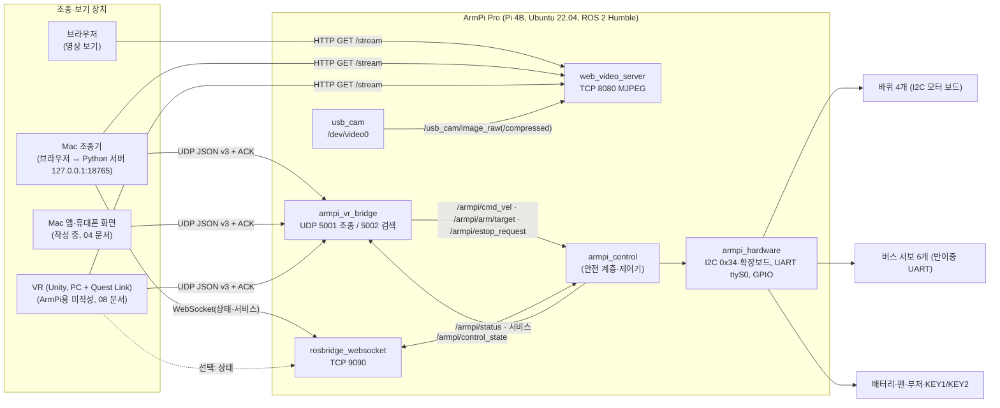
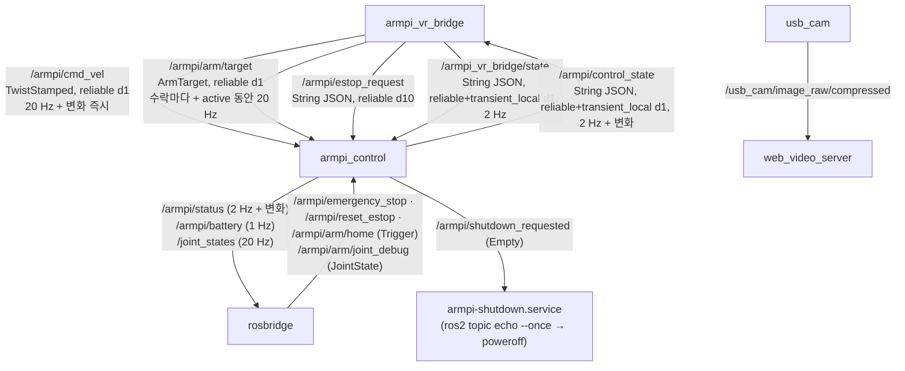
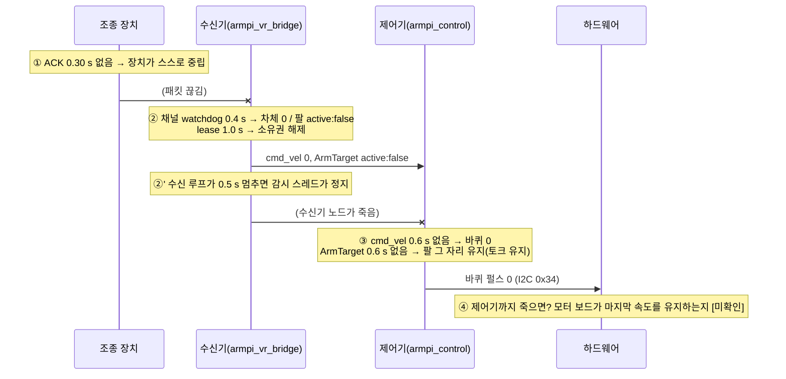
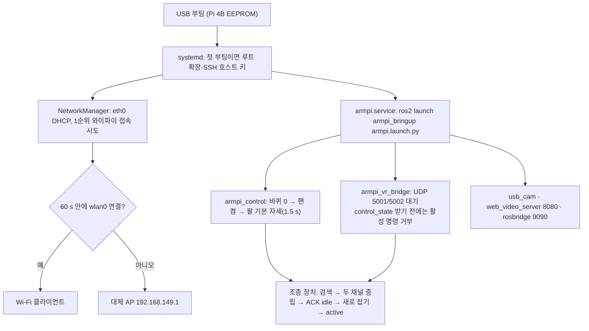

# 07. 통신 구조 — 장치에서 바퀴·서보까지

작성 2026-11-02 22:4x KST. 표기: [코드], [시험 로그](경로), [추정], [미확인].
**실제 로봇·실제 Wi‑Fi에서 잰 값은 하나도 없다.** 아래 숫자는 모두 같은 컴퓨터 안(루프백) 또는 컨테이너 안에서 나온 것이다.

## 1. 전체 그림

- **조종은 UDP 하나뿐이다.** 모든 조종 장치는 같은 Protocol v3로 같은 수신기에 붙는다. 한 번에 **한 조종자**만 가진다(UUID + 송신 주소).
- rosbridge는 상태 보기와 보조 명령(전체 비상정지·해제·기본 자세·관절 디버그)용이다. 끊겨도 조종은 계속된다.
- 영상은 조종과 완전히 따로다. 영상이 끊겨도 로봇 안전에 영향이 없다.

## 2. 포트 표

| 포트 | 프로세스 | 방향 | 용도 | 인증 | 근거 |
|---|---|---|---|---|---|
| UDP 5001 | `armpi_vr_bridge_node` | 장치 → 로봇, ACK는 같은 소켓으로 되돌림 | Protocol v3 조종 | 없음(`allowed_sources` CIDR 선택) | [코드] `armpi.yaml` |
| UDP 5002 | 같은 노드(검색 스레드) | 브로드캐스트 → 로봇, 응답 출발 포트 5002 | 로봇 찾기 `ARMPI_DISCOVER/1` | 없음 | [코드] |
| TCP 9090 | rosbridge‑suite 2.0.8 | 양방향 WebSocket | 상태·서비스 | 없음 | [코드] `armpi.launch.py` |
| TCP 8080 | web_video_server 3.1.0 | 로봇 → | MJPEG 스트림·스냅샷 | 없음 | [코드] |
| TCP 18765 | Mac 조종기(`armpi_mac_controller.py`) | **Mac 안에서만**(127.0.0.1) | 조종 화면·HTTP API | Host·Origin 검사 | [코드] |
| TCP 18765(로봇) | 로봇 안 웹 조종기 `armpi-web.service`(v1 파이썬, **v2 C++ `armpi_web_gateway`**) | 같은 망(0.0.0.0) | 휴대폰·PC 조종 화면·HTTP API. 조종은 UDP 127.0.0.1:5001, 상태는 v2 부터 rclcpp(rosbridge 안 거침) | Host·Origin·Content-Type 검사, 인증 없음 | [코드] v2 모의 시험 |
| TCP 22 | sshd | | 관리 | 비밀번호 + 키 | [코드] `10-armpi.conf` |
| UDP 7400+ | ROS 2 DDS | 같은 망 | ROS 2 도구 | **없음** — `ROS_LOCALHOST_ONLY=0` | [코드] `armpi.service` |
| UDP 5353 | avahi | | `armpi-ros2.local` | | [코드] |

## 3. 장치 ↔ 로봇: Protocol v3 요약

전체 규격: `docs/01_PROTOCOL_V3_SPEC.md`. VR 쪽 설명: `docs/08_VR_HANDOFF_KO.md`.

| 메시지 | 방향 | 필드 수 | 주기 |
|---|---|---|---|
| `command`(차체 forward·strafe·turn) | 장치 → | 8 | 채널마다 20 Hz + 놓기·포커스 상실 때 즉시 |
| `arm_command`(손끝 x·y·z·pitch·gripper) | 장치 → | 10 | 채널마다 20 Hz |
| `emergency_stop`·`clear_emergency`·`disconnect` | 장치 → | 4 | 비상정지는 ACK까지 50 ms마다 재전송 |
| `ack` | → 장치 | 8(실수 없음) | 받은 패킷마다 1개 |

검색: `ARMPI_DISCOVER/1|<32 hex nonce>` → `ARMPI_HERE/1|<nonce>|<32 hex id>|<이름>|5001|3`. 식별자는 SHA‑256("armpi-discovery-v1:" + machine‑id) 앞 32 hex [코드: `discovery.cpp`]. 초당 최대 20회 응답.

## 4. 로봇 내부 ROS 2 토픽·QoS

| 토픽·서비스 | 타입 | 발행 → 구독 | QoS | 내용 |
|---|---|---|---|---|
| `/armpi/cmd_vel` | `geometry_msgs/TwistStamped` | 수신기 → 제어기 | reliable, depth 1 | frame `base_link`, m/s·rad/s. stamp 0.5 s 넘게 차이 나면 제어기가 버림 |
| `/armpi/arm/target` | `armpi_interfaces/ArmTarget` | 수신기 → 제어기 | reliable, depth 1 | frame `armpi_arm_base`, `active:false` = 그 자리 유지 |
| `/armpi/estop_request` | `std_msgs/String` | 수신기 → 제어기 | reliable, depth 10 | `{"source":"udp","latch":true\|false}` |
| `/armpi_vr_bridge/state` | `std_msgs/String` | 수신기 → 제어기 | reliable, **transient_local**, depth 1 | owner, 채널 상태, 패킷 수 |
| `/armpi/control_state` | `std_msgs/String` | 제어기 → 수신기 | reliable, **transient_local**, depth 1 | `estop`, `estop_sources`, `fault`, `fault_reason`, `udp_allowed` |
| `/armpi/status` | `std_msgs/String` | 제어기 → rosbridge | reliable, depth 1 | 사람용 종합 상태(배터리, 팔 목표·현재, `position_source` 등) |
| `/armpi/battery` | `sensor_msgs/BatteryState` | 제어기 → | reliable, depth 10 | V |
| `/joint_states` | `sensor_msgs/JointState` | 제어기 → | reliable, depth 10 | joint1–5, r_joint(명령값 기준) |
| `/armpi/shutdown_requested` | `std_msgs/Empty` | 제어기 → 종료 서비스 | reliable, depth 1 | KEY2 2 s |
| `/armpi_control/hw_state` | `std_msgs/String` | 제어기 → | reliable, depth 1 | 진단(바퀴 펄스, 서보 명령값, 실패 횟수) |
| `/armpi/arm/joint_debug` | `sensor_msgs/JointState` | → 제어기 | reliable, depth 10 | UDP 조종자가 없을 때만 적용 |
| `/armpi/emergency_stop`, `/armpi/reset_estop`, `/armpi/arm/home` | `std_srvs/Trigger` | → 제어기 | 서비스 | |

[코드: `bridge_node.cpp`, `control_node.cpp`]

- transient_local = 나중에 구독해도 마지막 값을 받는다(ROS 1의 latch). 수신기는 제어기 상태를 받기 전에는 활성 명령을 `not_owner`로 거부한다.
- `ROS_DOMAIN_ID=0`, `ROS_LOCALHOST_ONLY=0`(같은 망의 PC에서 `ros2 topic` 사용 가능) [코드: `deploy/systemd/armpi.service`].

### 4.1 큰 메시지(카메라 원시)와 DDS 설정 (v2)

- 카메라 원시 `/usb_cam/image_raw`(640×480 rgb8)는 한 장 921,600 B 다. v1 실기에서 best-effort 구독은 12.56 Hz 를 받았지만 RELIABLE 구독(web_video_server)에는 새 영상이 오지 않았다(`11_KNOWN_LIMITATIONS_KO.md` 00절, 원인은 추정).
- v2: `armpi.launch.py` 가 `armpi_bringup/config/fastdds_armpi.xml`(공유 메모리 세그먼트 8 MiB, UDPv4 버퍼 4 MiB)을 적용하고(`dds_profile:=""` 이면 끔), 이미지에 `/etc/sysctl.d/60-armpi-dds.conf`(소켓 버퍼 상한 16 MiB·기본 4 MiB, IP 조각 설정)를 넣는다. **실기 미확인.**
- **기본값(2026-11-04 실기 뒤): 웹 화면 영상을 best-effort 로 받는다** — `armpi.yaml` 의 `armpi_web_gateway.camera_qos_profile: "sensor_data"`(web_video_server 스트림 주소의 `qos_profile`). 원시 영상은 반드시 `qos_profile=sensor_data`(best-effort)로 받는다. 기본(RELIABLE)으로 받으면(스냅샷·`type=mjpeg` 포함) 로봇 안 ROS 통신이 막힐 수 있다(2026-11-04 실기, `docs/11` 0절). 화질은 같고, 늦게 온 장을 다시 보내지 않고 버리는 차이뿐이다.

## 5. 안전 사슬 (끊김 → 정지)

| 단계 | 감시 | 시간 | 동작 | 근거 |
|---|---|---|---|---|
| ① 장치 | ACK 시간 초과 | 0.30 s | 두 채널 중립, 사용자 표시 | spec §4, `armpi_v3_client.py` |
| ② 수신기 | 채널 watchdog | 0.4 s | 차체 정지 / 팔 유지, 상태 `timeout` | [코드] |
| ②' 수신기 | 수신 루프 정지 감시 | 0.5 s | 세션 정지, 스레드가 끝났으면 fault | [코드] `udp_server.cpp` |
| ②'' 수신기 | 제어기 상태 나이 | 2.0 s | 활성 명령 `not_owner` | [코드] |
| ②''' 수신기 | lease | 1.0 s | 소유권 해제 | [코드] |
| ③ 제어기 | cmd_vel 2차 watchdog | 0.6 s | 바퀴 0 | [코드] |
| ③ 제어기 | ArmTarget 시간 초과 | 0.6 s | 팔 그 자리(새 명령 안 보냄, 토크 유지) | [코드] |
| ③ 제어기 | stamp 나이 | 0.5 s | 그 cmd_vel 버림 | [코드] |
| ③ 제어기 | 쓰기 연속 실패 | 5회 | fault, 바퀴 0 재시도 | [코드] |
| ④ 하드웨어 | — | — | 소프트웨어 밖. **독립 비상정지 장치 없음** | `11_KNOWN_LIMITATIONS_KO.md` |

비상정지 경로(소프트웨어): UDP `emergency_stop`(누구나 latch, 소유자만 해제) / rosbridge `/armpi/emergency_stop` 서비스 / 로봇 **KEY1** 버튼. 서비스·버튼으로 건 것은 `/armpi/reset_estop`으로만 풀린다. 걸리면 바퀴 즉시 0, 팔은 토크를 유지한 채 그 자리, 부저 0.1 s [코드].

**주의(우회 경로):** rosbridge 9090이나 DDS로 `/armpi/cmd_vel`을 직접 발행하면 UDP 세션 규칙(소유권·중립 확인)을 거치지 않는다. 제어기의 2차 watchdog·stamp 검사·비상정지만 남는다 [코드, `11_KNOWN_LIMITATIONS_KO.md`].

## 6. 지연 측정값 (있는 것만)

| 측정 | 값 | 조건 | 로그 |
|---|---|---|---|
| 마지막 활성 명령 → 수신기가 cmd_vel 0 발행 | 0.403 s | 컨테이너 루프백, watchdog 0.4 s 설정 | (시험 기록) |
| 마지막 팔 수락 → ArmTarget active:false | 0.407 s (이전 실행 0.419 s) | 같음 | 같음, `vr_bridge_all_20261102_214605/integration.txt` |
| cmd_vel 발행 수 | 1.0 s 동안 20개(이전 실행 19개) | 같음 | 같음 |
| Mac 조종기 ↔ 가짜 로봇 ACK 왕복 | 중앙 2.62 ms, 최대 2.95 ms | Mac 안 루프백(Python 가짜 로봇) | (시험 기록) |
| 브라우저 입력 끊김 → 중립 정지 확인 | 331 ms | 입력 timeout 300 ms 포함, 같은 Mac | 같음 |
| 비상정지 → 가짜 로봇 상태 반영 | 14 ms | 같은 Mac | 같음 |
| 키 입력 → 가짜 로봇 상태 반영 | 55–163 ms | **상태 토픽(2 Hz) 경유라 지연값이 아님** | 같음 |
| C# 예제 ↔ 가짜 로봇 ACK 왕복 | 23회 중앙 0.09 ms, 최대 1.01 ms | 같은 컨테이너 루프백 | (시험 기록) |

- 이 값들은 **Wi‑Fi·실제 하드웨어 지연을 포함하지 않는다.** 결과 보고에서 로봇 지연으로 쓰면 안 된다.
- 실제 측정 방법(구간 정의, 공통 시계, 고속 카메라)은 `10_HARDWARE_TEST_PLAN_KO.md` M절.
- **시계 문제:** 로봇에는 RTC가 없다. 새 이미지는 systemd‑timesyncd가 인터넷이 될 때만 맞춘다. 장치와 로봇의 타임스탬프 차이를 지연으로 쓰려면 먼저 시계 동기 오차를 재야 한다. Protocol v3에는 송신 시각 필드가 없다 → RTT/2 근사 또는 외부 카메라.

## 7. 네트워크

| 항목 | 값 | 근거 |
|---|---|---|
| 관리 | NetworkManager만(systemd‑networkd 끔, wait‑online 마스크) | [이미지 설정] |
| 유선 | `armpi-eth0`: eth0 DHCP(IPv4·IPv6), 우선순위 10 | [이미지 설정] |
| Wi‑Fi 클라이언트 | **우선순위: 1순위 와이파이 → 2순위 와이파이 → 대체 AP.** `armpi-wifi`: SSID **1순위 와이파이**(우선순위 100), v2 `armpi-wifi2`: SSID **2순위 와이파이**(50, 비밀 파일이 있을 때만). 비밀번호는 (내부 기록)에만, 문서에 쓰지 않음 | [시험 로그] 20단계 로그 "armpi-wifi: SSID=1순위 와이파이", v1 실기 B3 통과. 2순위는 가짜 비밀 파일 시험만 |
| 대체 AP | 부팅 후 **60 s** 안에 Wi‑Fi 연결이 안 되면 `armpi-ap` 켬: SSID `ArmPi-ROS2`, 2.4 GHz ch6, WPA2(비밀번호는 문서에 적지 않음(담당자에게 확인)), 로봇 **192.168.149.1**/24, 접속 기기에 DHCP | [코드] `armpi-net-fallback`, `armpi-ap.nmconnection` |
| 무선 규정 | 국가 코드 KR(`REGDOMAIN=KR`, 커널 인자 `cfg80211.ieee80211_regdom=KR`) | [코드] |
| Wi‑Fi 절전 | 끔(`wifi.powersave = 2`) | [코드] |
| mDNS | `armpi-ros2.local`(avahi) | [코드] |
| 호스트명 | `armpi-ros2` | [이미지 설정] |
| SSH | `ubuntu@armpi-ros2.local`, Mac 키 `~/.ssh/id_ed25519_armpi` 등록, 비밀번호 로그인도 허용 | [코드] |

- 대체 AP는 Wi‑Fi가 **처음 60 s 안에** 안 붙을 때만 켜진다. 나중에 Wi‑Fi가 끊겼을 때 다시 AP로 바꾸지는 않는다 [코드: oneshot 서비스].
- 대체 AP에 붙으면 장치 쪽 로봇 주소는 192.168.149.1이다. 검색(5002 브로드캐스트)도 이 망 안에서 된다.
- 1순위 와이파이는 여러 사람이 쓰는 망일 수 있다 → 9절 보안.
- 실제 Wi‑Fi 연결·AP 전환은 **실기 미확인**이다.

## 8. 실행 순서 (부팅 → 조종 가능)

`armpi.service`의 `After=network.target`은 네트워크 연결 완료를 기다리지 않는다. 수신기는 `0.0.0.0`에 묶이므로 나중에 생긴 주소에서도 받는다 [코드].

## 9. 보안 한계

| 통로 | 현재 | 위험 | 대응(선택) |
|---|---|---|---|
| UDP 5001 | 암호화·인증 없음 | 같은 망 누구나 조종 시도 가능. 비소유자도 비상정지 latch 가능(설계상) | `allowed_sources`에 Mac·VR PC 주소만. 단 IPv4 출처는 **위조 가능** |
| rosbridge 9090 | 인증 없음, 모든 토픽·서비스 | `/armpi/cmd_vel` 직접 발행으로 UDP 규칙 우회, 비상정지 해제 서비스 호출 가능 | 쓰지 않을 때 `rosbridge:=false`, 방화벽 |
| DDS | `ROS_LOCALHOST_ONLY=0` | 같은 망 ROS 2 도구가 모든 토픽에 접근. `/armpi/shutdown_requested`를 보내면 `armpi-shutdown.service`가 로봇을 끈다 | 신뢰 못 하는 망이면 1 |
| MJPEG 8080 | 인증 없음 | 영상 노출 | |
| SSH | 비밀번호 로그인 허용, `ubuntu` NOPASSWD sudo | 비밀번호를 아는 사람은 root | 키만 허용으로 바꾸기 검토 |
| Wi‑Fi | 1순위 와이파이 공용 망 가능성 | 위 전부가 그 망에 노출 | 실험은 대체 AP 또는 전용 공유기 [제안] |

이 문서와 다른 문서에는 비밀번호·PSK를 적지 않는다.
