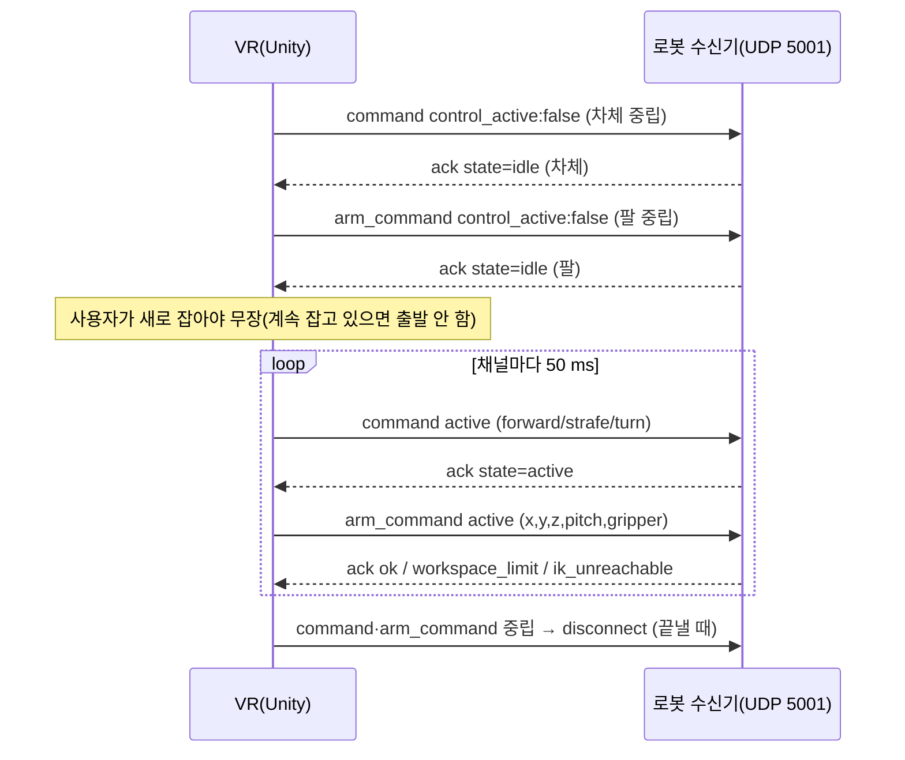

# 08. VR 담당자에게 넘길 것 (ArmPi Protocol v3 인계서)

작성 2026-11-02 22:3x KST. 대상: ArmPi Pro용 VR 클라이언트(Unity 등)를 만들 사람.
VR/XR 구현 담당자와 역할은 **아직 정해지지 않았다**(친구·공동 연구자가 맡을 가능성). 이 문서는 누가 맡든 바로 시작할 수 있게 쓴다.

표기
- **[코드]** 이 프로젝트 코드에서 확인
- **[시험 로그]** 모의 시험 결과(경로 함께). 전부 Mac·컨테이너 루프백이다
- **[계산]** 이 프로젝트 기구학 식으로 계산한 값(소프트웨어 기준)
- **[제안]** 아직 합의 전인 설계 제안
- **[미확인]** 근거 없음 또는 아직 확인하지 않음

**실제 로봇·실제 Wi‑Fi·Quest 실기 시험은 0건이다.** 아래 "통과"는 모두 가짜 로봇 또는 컨테이너 안 C++ 수신기 기준이다.

## 0. 한 장 요약

| 항목 | 내용 |
|---|---|
| 규격 | `docs/01_PROTOCOL_V3_SPEC.md` (Protocol v2를 넓힌 것) |
| 조종 통로 | UDP **5001**, JSON 1개 = 데이터그램 1개, 같은 소켓으로 ACK |
| 로봇 찾기 | UDP **5002** `ARMPI_DISCOVER/1\|<nonce>` → `ARMPI_HERE/1\|…\|3` |
| 영상 | HTTP MJPEG `http://<IP>:8080/stream?topic=/usb_cam/image_raw&type=ros_compressed&qos_profile=sensor_data` |
| 상태(선택) | rosbridge WebSocket 9090, `/armpi/status`(JSON 문자열) |
| VR 쪽 할 일 | ① 번호 2→3 ② `command`에 `strafe` 추가 ③ 새 `arm_command` 송신 ④ 채널별 ACK 처리 ⑤ 새 reason 2개 ⑥ 검색 문자열 `ARMPI_*` ⑦ Unity↔ROS 좌표 변환 ⑧ 컨트롤러→팔 매핑 |
| 바로 쓸 코드 | `clients/vr_handoff/ArmPiV3Messages.cs` (메시지 만들기·ACK 해석·검색·좌표 변환·IK 미리 확인·매핑 제안, Unity 의존 없음) |
| 로봇 없이 시험 | `protocol_v3/mock_robot.py`(가짜 로봇) + `conformance_test.py`(적합성 시험) — 9절 |

## 2. 메시지 (정확한 형식)

공통 규칙 [코드: `armpi_vr_bridge/src/protocol.cpp`, `strict_json.cpp`]
- 필드가 빠지거나 더 있거나 키가 중복되면 `invalid_packet`.
- `protocol`·`sequence`는 **정수만**(`3.0`도 불가). 축·좌표는 숫자(정수·실수 모두 가능). NaN·Infinity·문자열·불리언 불가.
- `client_id`: 하이픈 포함 36자 UUID, nil 불가, 대소문자 무시.
- `sequence`: 0–9,007,199,254,740,991. **차체·팔·이벤트가 한 줄로 증가**한다. 같은 번호 재전송 → `out_of_order`.
- 최대 2,048 B.

### 2.1 `command` — 차체 (정확히 8필드)

```json
{"protocol":3,"type":"command","client_id":"d8b27f10-09a8-4c21-b649-1e7058d46b72","sequence":123,
 "control_active":true,"forward":0.6,"strafe":0.0,"turn":-0.3}
```

| 필드 | 범위 | 뜻 | 로봇 변환(초기 상한) |
|---|---|---|---|
| forward | −1–1 | + 앞 | `vx = forward × 0.25 m/s`(로봇 설정 상한) |
| strafe | −1–1 | + **왼쪽**(REP‑103) | `vy = strafe × 0.25 m/s` |
| turn | −1–1 | + 좌회전(위에서 볼 때 반시계) | `wz = turn × 1.2 rad/s` |

- 차체 중립 = `control_active:false`, 또는 `true`이면서 세 축 0.
- 상한은 로봇 설정 `chassis.max_*`이고 **실측 전 보수값**이다 [코드: `vr_bridge.yaml`].
- 메카넘이라 forward+strafe 동시 입력 = 대각선 이동이다.
- **회전 부호는 실기 미확인이다**(`chassis.angular_sign`). VR 쪽에서 부호를 뒤집지 말고, 실기에서 로봇 쪽 설정으로 맞춘다.

### 2.2 `arm_command` — 팔·그리퍼 (정확히 10필드)

```json
{"protocol":3,"type":"arm_command","client_id":"…","sequence":124,
 "control_active":true,"x":0.1047,"y":0.0,"z":0.0753,"pitch":-1.0263,"gripper":0.0}
```

| 필드 | 단위·범위 | 뜻 |
|---|---|---|
| x, y, z | m, 작업 공간 상자 안 | `armpi_arm_base` 좌표(REP‑103: x 앞, y 왼쪽, z 위)에서 **손끝(그리퍼 끝점)의 절대 목표** |
| pitch | rad, −π–π | 손 링크가 수평 앞과 이루는 각. 0 = 수평 앞, −π/2 = 아래, + 위 |
| gripper | 0–1 | 0 = 완전히 열림, 1 = 완전히 닫힘 |

- 손끝의 좌우 방향(yaw)은 따로 없다. 목표 위치에서 `atan2(y, x)`로 정해진다. 손목 회전(joint5)은 프로토콜에 없고 로봇이 고정한다(서보 500) [코드: `arm_controller.hpp` `joint5_servo_value`].
- 로봇은 목표로 **점프하지 않는다.** 손끝 직선 0.15 m/s, pitch 1.0 rad/s, 그리퍼 1.0/s로 보간한다 [코드: `armpi_control` 기본값].
- ACK `ok`는 "규칙상 수락"이다. **도착했다는 뜻이 아니다.**
- 팔 중립 = `control_active:false`. 좌표는 무시되고 팔은 현재 위치에 선다. 그래도 숫자 5개는 유효해야 한다. 마지막 수락값을 넣는다.

### 2.3 이벤트 (정확히 4필드)

```json
{"protocol":3,"type":"emergency_stop","client_id":"…","sequence":125}
```
`type`: `emergency_stop` / `clear_emergency` / `disconnect`.

### 2.4 ACK (로봇 → VR, 정확히 8필드, 값은 문자열·불리언·정수·null만)

```json
{"protocol":3,"type":"ack","client_id":"…","sequence":124,"accepted":true,"reason":"ok","emergency_stop":false,"state":"active"}
```

- 키 순서는 위와 같다 [코드: `protocol.cpp` `encode_ack`]. 순서에 기대지 말고 이름으로 읽는다.
- 식별할 수 없는 패킷의 ACK: `client_id:null`, `sequence:-1` → 무시한다.
- 실수 값은 없다. 그래서 기존 Unity 파서의 "실수 금지" 규칙을 그대로 쓸 수 있다.
- **보낸 주소·포트가 아닌 곳에서 온 ACK는 버린다**(UDP `Connect` 사용).

| state | 뜻 | VR 동작 |
|---|---|---|
| `awaiting_neutral` | 시작·새 조종자·비상정지 해제·timeout 뒤 중립 대기 | 그 채널 중립 송신 |
| `idle` | 중립 확인됨 | 사용자가 **새로** 잡으면 무장 |
| `active` | 활성 명령 적용 중 | 계속 |
| `timeout` | 그 채널 watchdog 0.4 s 만료(차체 정지 / 팔 그 자리 유지) | 무장 해제, 중립부터 다시 |
| `emergency_stop` | latch | 모든 채널 무장 해제 |
| `fault` | 하드웨어 출력 실패 등. 로봇 재시작 필요 | 모든 채널 무장 해제, 사용자에게 표시 |

| reason | 뜻 | VR 동작 |
|---|---|---|
| `ok` | 수락 | — |
| `invalid_packet` | 형식 오류 | 버그. 로그 남김 |
| `unsupported_protocol` | protocol ≠ 3 | 버그 |
| `out_of_order` | 이전 번호 이하 | 무시 |
| `not_owner` | 다른 조종자가 소유 / retire된 UUID / 로봇이 다른 경로(home·관절 디버그)에 팔을 쓰는 중 | 무장 해제. 사용자 표시 |
| `emergency_stop` | 비상정지 중 활성 명령 | 무장 해제 |
| `neutral_required` | 중립 확인 전 활성 명령 | 그 채널 중립부터 |
| `fault` | fault 중 활성 명령 | 무장 해제 |
| `workspace_limit` **[v3]** | 팔 목표가 작업 공간 상자 밖 | **팔 채널 유지.** 목표를 마지막 수락값으로 되돌리고 진동·표시 |
| `ik_unreachable` **[v3]** | 팔 목표에 IK 해 없음 | 위와 같음 |

거부(`workspace_limit`·`ik_unreachable`)는 로봇 watchdog을 갱신하지 않는다. 거부만 계속 보내면 0.4 s 뒤 팔 채널이 `timeout`이 된다 [코드: spec §2.2, `session.cpp`].

## 3. VR 쪽 세션 규칙

참조 구현: `protocol_v3/armpi_v3_client.py` `ArmPiV3Client` [코드].

### 3.1 연결과 무장



| 규칙 | 값·내용 | 근거 |
|---|---|---|
| UUID | 연결 버튼마다 새 UUID. 자동 소켓 복구는 같은 UUID | |
| sequence | 1부터. 차체·팔·이벤트 공용 증가 | spec §2 |
| 송신 주기 | **채널마다** 평균 20 Hz(50 ms). 두 채널이면 초당 약 40개 | spec §1 |
| 즉시 추가 송신 | 놓기·추적 상실·일시정지·포커스 상실 → 그 채널 중립 1회 | spec §1 |
| 무장 | 그 채널 중립을 보내고 ACK `idle`을 받은 뒤, 사용자가 **새로** 잡을 때 | |
| ACK 시간 초과 | **0.30 s** 동안 ACK 없음 → 두 채널 무장 해제, 중립 송신 | spec §4 |
| 자동 재무장 | 시간 초과·watchdog·lease 때문에 풀렸으면, 사용자가 계속 잡고 있는 동안 "중립 → idle 확인 → 활성"을 다시 밟아도 된다(Mac 조종기 방식). 비상정지·해제·fault·not_owner 뒤에는 **반드시 놓았다 다시 잡기** | `armpi_v3_client.py` |
| 재연결 | 소켓 오류 뒤 **1.1 s** 기다렸다가 같은 UUID로(로봇 lease 1.0 s) | spec §4 |
| 종료 | 두 채널 중립 + `disconnect` 1회. 이 UUID는 로봇이 재시작할 때까지 다시 못 쓴다 | spec §3 |

### 3.2 비상정지 재전송 규칙

1. 버튼을 누르는 즉시 `emergency_stop`을 보낸다.
2. ACK(`emergency_stop:true`)를 받을 때까지 **50 ms마다 새 sequence로** 다시 보낸다.
3. 그동안 두 채널 모두 무장 해제하고 중립만 보낸다.
4. 소유자가 아닌 클라이언트의 비상정지도 로봇이 latch한다(관찰자 PC도 누를 수 있다).
5. 해제(`clear_emergency`)는 **소유자만** 된다. 해제 뒤 **두 채널 모두** 새 중립이 필요하다.
6. 로봇 전체 비상정지(서비스 `/armpi/emergency_stop`, 로봇 KEY1 버튼)가 걸려 있으면 UDP 해제로는 풀리지 않는다. ACK `emergency_stop:true`가 계속 온다 [코드: `control_node.cpp` `estop_source_releasable_by_request`].
7. 비상정지 때 로봇 동작: 차체 즉시 정지, **팔은 그 자리에서 토크 유지**(떨어지지 않음), 그리퍼도 그대로.

**소프트웨어 비상정지다.** 로봇 프로그램이 멈추면 듣지 않는다. 실기에서는 사람이 전원 스위치를 잡고 있어야 한다(`10_HARDWARE_TEST_PLAN_KO.md`).

## 4. 시간 값 (로봇 기본값)

| 값 | 기본 | 뜻 |
|---|---|---|
| 차체 watchdog | 0.4 s | 마지막 인정 `command` 뒤 → 차체 정지 |
| 팔 watchdog | 0.4 s | 마지막 인정 `arm_command` 뒤 → 팔 그 자리 유지 |
| lease | 1.0 s | 어느 채널이든 인정 패킷이 없으면 소유권 해제 |
| 제어기 2차 감시 | 0.6 s | 수신기가 죽어도 정지 |
| VR ACK 시간 초과 | 0.30 s | VR이 먼저 멈춘다(로봇 0.4 s보다 짧게) |

모두 **실측 전 값**이다. Wi‑Fi 지연 측정 뒤 조정한다.

## 5. 좌표 변환 (Unity ↔ ROS)

| | Unity | ROS REP‑103 (`armpi_arm_base`, `base_link`) |
|---|---|---|
| 손잡이 | 왼손 | 오른손 |
| 앞 | +Z | +x |
| 왼쪽 | −X | +y |
| 위 | +Y | +z |
| 단위 | 1 unit = 1 m로 가정 | m, rad |

```text
위치    ros   = (  u.z,  −u.x,   u.y )
        unity = ( −r.y,   r.z,   r.x )
회전    q_ros   = ( −q.z,  q.x, −q.y,  q.w )     // (x, y, z, w) 순서
        q_unity = (  r.y, −r.z, −r.x,  r.w )
pitch   f = q_unity · (0,0,1)  → f_ros = ros(f) → pitch = atan2(f_ros.z, √(f_ros.x² + f_ros.y²))
```

- 손잡이가 바뀌므로 쿼터니언 벡터부의 부호가 바뀐다. 위 식은 무작위 회전 1,000개에서 "점을 돌린 뒤 바꾼 것"과 "바꾼 뒤 돌린 것"이 같음을 확인했다 [시험 로그: (시험 기록)].
- 예: Unity에서 +Y축 +90° 회전(위에서 볼 때 오른쪽으로 돌기) → ROS에서 z축 −90°(시계 방향). 같은 로그에서 확인.

C# 사용 예 (`clients/vr_handoff/ArmPiV3Messages.cs`):

```csharp
using ArmPi.V3;
// anchor: 로봇 앞 방향을 +Z로 맞춘 Unity 오브젝트(조작 기준)
UnityEngine.Vector3 lp = anchor.InverseTransformPoint(controller.position);
UnityEngine.Quaternion lq = UnityEngine.Quaternion.Inverse(anchor.rotation) * controller.rotation;
Vec3 hand = new Vec3(lp.x, lp.y, lp.z);
Quat rot  = new Quat(lq.x, lq.y, lq.z, lq.w);
Vec3 handRos = ArmPiFrames.RosFromUnity(hand);          // m, REP-103
double pitch = ArmPiFrames.ControllerPitch(rot);        // rad, 0 = 수평, −π/2 = 아래
```

`armpi_arm_base`와 차체 `base_link` 사이 변환(팔이 차체 어디에 붙었는지)은 **아직 정의되지 않았다** [미확인]. VR에 로봇 모형을 그릴 때 필요하다. 실기에서 줄자로 재야 한다.

## 6. 컨트롤러 → 로봇 매핑 [제안]

### 6.1 버튼 배치 (Quest 컨트롤러, 오른손잡이 기준)

| 입력 | 동작 | 이유 |
|---|---|---|
| 오른손 **그립**(누르는 동안) | 팔 조종 켜기(clutch). 놓으면 `arm_command control_active:false` → 팔 그 자리 유지 | 손을 떼면 바로 멈춤(dead‑man). |
| 오른손 **트리거**(아날로그 0–1) | `gripper` 목표 | 누른 만큼 닫힘. 로봇이 1.0/s로 보간 |
| 왼손 **그립**(누르는 동안) | 차체 조종 켜기 | 위와 같음 |
| 왼손 썸스틱 Y / X | `forward` / `strafe` | **strafe = −stick.x**(스틱 왼쪽 = +왼쪽) |
| 오른손 썸스틱 X | `turn` | **turn = −stick.x**(스틱 왼쪽 = 좌회전 +) |
| 오른손 **B** | 비상정지 | |
| 왼손 **Y**(그립 놓은 상태) | 비상정지 해제 요청 | |
| 왼손 **X** | 카메라 패널 켜기·끄기 | |

- 데드존: 썸스틱이면 0.1–0.15 정도를 제안한다 [제안].

### 6.2 팔: 상대 이동(clutch) 방식

팔이 작다(어깨 위로 뻗어도 약 0.36 m) [계산]. 사람 팔 범위와 크기가 달라서 **절대 위치 매핑보다 상대 이동이 안전하다.**

1. 그립을 누르는 순간: 컨트롤러 자세 P0와 로봇 손끝 현재값 T0를 기억한다.
   - T0 = rosbridge `/armpi/status`의 `arm_current`. 없으면 마지막 수락 목표, 그것도 없으면 기본 자세(7절).
   - `arm_current`는 **명령값 기준**이다(`position_source:"commanded"`). 실제 측정값이 아니다.
2. 누르는 동안: `목표 = T0 + ros(P − P0) × Scale`. pitch는 `T0.pitch + (컨트롤러 pitch − 처음 pitch)`.
3. 작업 공간 상자로 자르고, 0.15 m/s·1.0 rad/s로 한 걸음씩만 움직인다(로봇 보간 속도와 같게).
4. 로봇과 같은 IK로 미리 확인해서, 안 풀리면 직전 목표를 유지한다(거부 ACK를 줄인다).
5. 놓으면 목표를 그대로 두고 팔 채널 중립을 보낸다.

`ArmTeleopMapper`가 이 순서를 구현했다. 기본값: `Scale 1.0`, `MaxSpeed 0.10`, `MaxPitchRate 1.0`, pitch 범위 −π/2–0, 상자 = `Workspace.Robot`(7.3절, 로봇 `armpi.yaml` 값) [코드: `clients/vr_handoff/ArmPiV3Messages.cs`].

```csharp
var mapper = new ArmTeleopMapper();               // 로봇 설정이 바뀌면 Box·Kinematics 값도 같이 바꾼다
// 그립 누름
mapper.Engage(hand, rot, robotArmCurrentOrHome);
// 50 ms 마다(또는 매 프레임)
ArmTarget t = mapper.Update(hand, rot, triggerValue, dt);
long seq = NextSequence();
string json = ArmPiV3Json.ArmCommand(clientId, seq, armArmed, t.X, t.Y, t.Z, t.Pitch, t.Gripper);
// 그립 놓음
mapper.Release();                                  // 그리고 control_active:false 로 마지막 수락값 송신
```

시험(가짜 로봇 아님, 함수 단위): 손을 Unity 앞(+Z)으로 3 cm → 손끝 x +3 cm, 50 ms에 최대 5 mm, IK가 안 풀리는 곳에서 멈춤 [시험 로그: 같은 `selftest.txt`].

## 7. 팔 작업 공간·기본 자세·속도

### 7.1 기본 자세

| 항목 | 값 |
|---|---|
| 서보 ID 1–6 | 하드웨어 프로필 `arm.home_servo_values`(로봇마다 다름, 이 저장소에 없음), 1,500 ms |
| 손끝 | **x 0.1047 m, y 0, z 0.0753 m, pitch −1.0263 rad(−58.8°)** |
| 그리퍼 | 0 (열림) |

[설정: `ros2_ws/src/armpi_bringup/config/armpi.yaml` `arm.home`]. 프로필의 기본 자세 서보값은 이 손끝이 되도록 맞춘다.
로봇 제어기는 시작할 때 이 자세로 간다(`arm.home_on_start: true`). VR이 처음 팔을 켤 때 이 값을 T0로 써도 된다.

### 7.2 팔 치수와 관절 범위

링크 길이는 Hiwonder 공개 ArmPi FPV 기구학 값이다(ArmPi Pro 실측 확인 필요).

| 링크 | 길이 (m) |
|---|---|
| 바닥 → 어깨 축 | 0.064605 |
| 어깨 → 팔꿈치 | 0.10048 |
| 팔꿈치 → 손목 | 0.094714 |
| 손목 → 그리퍼 끝 | 0.16331 |

관절 범위: joint1·joint3 ±120°(Hiwonder 공개 ArmPi FPV 기구학 값). joint2·joint4 범위와 관절 기준(sign·offset)은 로봇의 하드웨어 프로필에서 받는다. 손목 축이 z=0 아래면 거부, 팔꿈치 굽힘 0.05 rad 미만 거부. C# `ArmPiKinematics`의 관절 기준·범위 기본값은 **시험용**(가짜 로봇과 같음)이므로, 실제 로봇과 같은 사전 판정이 필요하면 로봇 프로필 값으로 바꾼다. 최종 판정은 항상 로봇 ACK다.
`ArmPiKinematics`(C#)는 로봇 `armpi_kinematics`와 같은 식이다. 기본 자세 FK·IK 왕복, 도달 불가·관절 한계 예를 확인했다 [시험 로그]. 가짜 로봇의 `ik_unreachable` 판정과도 일치했다 [시험 로그: 2부].

### 7.3 작업 공간 상자

로봇 공통 설정 `ros2_ws/src/armpi_bringup/config/armpi.yaml`(2026-11-02 22:25 판)의 `/**` 구역이 수신기와 제어기에 **같은 값**을 준다 [코드].

| 축 | 범위 (m, `armpi_arm_base`) | 설정 파일 주석의 근거 |
|---|---|---|
| x | 0.05 – 0.32 | 0.05 미만은 베이스 축 근처라 joint1이 급회전. 0.32 위는 거의 편 특이 자세 |
| y | −0.25 – 0.25 | 옆 0.24 m 위치 포함 |
| z | −0.08 – 0.32 | 바닥 근처 / 그 위는 대부분 IK 해 없음 |

- VR 쪽 기본값: `Workspace.Robot`(위와 같은 값). 로봇 값이 바뀌면 같이 바꾼다.
- 가짜 로봇의 **기본** 상자는 다르다(0–0.30, ±0.25, −0.05–0.35). 가짜 로봇으로 시험할 때는 `--workspace 0.05,0.32,-0.25,0.25,-0.08,0.32`로 맞춰 띄운다(9절).
- 수신기 단독 실행용 `armpi_vr_bridge/config/vr_bridge.yaml`에는 아직 placeholder 기구학(링크 0.10/0.10/0.095/0.12)이 남아 있다. 로봇 전체 실행(`armpi.launch.py`)은 `armpi.yaml`을 쓰므로 영향이 없다. 수신기만 따로 띄울 때는 `params_file:=…/armpi.yaml`을 준다(`11_KNOWN_LIMITATIONS_KO.md`).
- 상자 근거·차체와의 충돌 여부는 **소프트웨어 계산**이다. 실기에서 확인한다(`10_HARDWARE_TEST_PLAN_KO.md`).

### 7.4 실제로 닿는 범위 (y = 0 단면) [계산]

상자 안이어도 IK가 안 풀리는 곳이 많다. 특히 **손끝이 아래를 향하면(pitch −90°) 거의 바닥 높이에서만 닿는다.** 그리퍼(0.163 m)가 길기 때문이다.

| pitch | z = 0 | z = 0.06 | z = 0.12 | z = 0.18 | z = 0.24 |
|---|---|---|---|---|---|
| −90° | x 0.024–0.159 | — | — | — | — |
| −60° | 0.143–0.261 | 0.077–0.220 | — | — | — |
| −45° | 0.199–0.303 | 0.067–0.276 | 0.116–0.209 | — | — |
| −30° | 0.238–0.335 | 0.202–0.320 | 0.077–0.280 | — | — |
| 0° | 0.237–0.333 | 0.261–0.358 | 0.244–0.350 | 0.042–0.320 | 0.084–0.248 |

- 1 mm 간격으로 계산한 최소–최대값이다. 중간에 빈 곳이 있을 수 있다. 상자(x ≤ 0.30)로 한 번 더 잘린다.
- 사양 예시 `(0.15, 0, 0.12, −π/2)`는 **실제 치수에서 도달 불가**다 [계산, 시험 로그].
- 이 표는 소프트웨어 기준이다. 실제 손끝 위치 정확도는 실기에서 재야 한다.
- 제안: VR에서 손끝 목표(유령 그리퍼)와 로봇 현재값을 함께 그리고, 거부·IK 막힘 때 색을 바꾼다.

### 7.5 속도 상한 (로봇 기본, 실측 전 보수값)

| 대상 | 상한 |
|---|---|
| 차체 앞뒤 / 좌우 | 0.25 m/s |
| 차체 회전 | 1.2 rad/s |
| 팔 손끝 직선 | 0.15 m/s |
| 팔 pitch | 1.0 rad/s |

위 상한은 사용자 결정 2026-11-04, 바퀴 방향 실기 시험 전에 올렸다(이전 0.10 m/s, 0.60 rad/s, 팔 0.10 m/s). VR 쪽에서 미리 뒤집거나 키우지 말고 로봇 설정을 따른다.
| 그리퍼 0→1 | 1.0 /s (약 1초에 완전히 닫힘) |
| 팔 관절(IK 뒤) | 2.0 rad/s |

[코드: `vr_bridge.yaml`, `control_node.cpp` 매개변수]

## 8. 카메라·미디어

| 항목 | 내용 |
|---|---|
| 스트림 | `http://<IP>:8080/stream?topic=/usb_cam/image_raw&type=ros_compressed&qos_profile=sensor_data` |
| 한 장 | `http://<IP>:8080/snapshot?topic=/usb_cam/image_raw&type=ros_compressed&qos_profile=sensor_data` |
| 서버 | web_video_server 3.1.0 (Humble apt). 이미지 20단계 로그에 설치 기록 [빌드 기록] |
| 형식 | `multipart/x-mixed-replace;boundary=boundarydonotcross`, 부분마다 `Content-Length` + JPEG |
| 해상도·fps | `armpi.launch.py` 기본값: `/dev/video0`, 640×480, 15 fps, `pixel_format:=yuyv2rgb`(JPEG 압축 전송용) [코드]. 실제 카메라로는 미확인 |
| 인증 | 없음 |
| QoS | **원시 영상은 반드시 `qos_profile=sensor_data`(best-effort)로 받는다. 기본(RELIABLE)으로 받으면(스냅샷·`type=mjpeg` 포함) 로봇 안 ROS 통신이 막힐 수 있다(2026-11-04 실기, `docs/11` 0절).** Unity 수신기도 주소에 `qos_profile=sensor_data` 를 그대로 붙인다 |


### 8.1 상태 표시(선택): rosbridge 9090

| 이름 | 방향 | 용도 |
|---|---|---|
| `/armpi/status` (`std_msgs/String`, JSON, 2 Hz+변화 시) | 로봇 → | `owner`, `base_state`, `arm_state`, `emergency_stop`, `estop_sources`, `fault`, `battery_v`, `battery_low`, `arm_target{x,y,z,pitch,gripper}`, `arm_current{…}`, `position_source`, `arm_ik_blocked` 등 [코드: `control_node.cpp` `status_json`] |
| `/armpi/battery` (`sensor_msgs/BatteryState`, 1 Hz) | 로봇 → | 전압 |
| `/joint_states` (20 Hz) | 로봇 → | joint1–5, r_joint (rad, 명령값 기준) |
| `/armpi/emergency_stop`, `/armpi/reset_estop` (`std_srvs/Trigger`) | → 로봇 | 로봇 전체 비상정지·전체 해제 |
| `/armpi/arm/home` (`std_srvs/Trigger`) | → 로봇 | 기본 자세(팔 조종 중·비상정지 중 거부) |

- rosbridge는 **조종 경로가 아니다.** UDP가 조종, rosbridge는 표시·보조다. rosbridge가 끊겨도 조종은 계속된다(Mac 조종기와 같은 구조).
- rosbridge도 인증이 없다. 같은 망의 누구나 서비스를 부를 수 있다.

## 9. 로봇 없이 VR 앱 시험하기

가짜 로봇은 Python 표준 라이브러리만 쓴다. Mac·Linux에서 확인했다. Windows에서는 실행해 보지 않았다 [미확인].

### 9.1 같은 PC에서 (Unity 에디터 + 가짜 로봇)

```bash
cd ArmPro_Cpp_ROS2
python3 protocol_v3/mock_robot.py --bind 127.0.0.1 --workspace 0.05,0.32,-0.25,0.25,-0.08,0.32
#   UDP 5001/5002, 가짜 rosbridge 9090, 가짜 카메라 8080. 작업 공간은 로봇 armpi.yaml 값과 맞춤
# Unity: 로봇 주소 127.0.0.1 (검색은 127.0.0.1 로 유니캐스트)
```

### 9.2 다른 PC(Mac)에서 가짜 로봇, VR PC가 접속

```bash
python3 protocol_v3/mock_robot.py --bind 0.0.0.0 --workspace 0.05,0.32,-0.25,0.25,-0.08,0.32   # 같은 망 전체에 열림(시험할 때만)
#   방화벽에서 UDP 5001·5002, TCP 9090·8080 허용
#   VR PC: 기기 검색(브로드캐스트) 또는 Mac IP 직접 입력
```

- Mac의 colima(Docker)는 UDP를 Mac 밖으로 넘기지 않는다. 가짜 로봇은 **컨테이너가 아니라 Mac에서 직접** 돌린다. (컨테이너 안 C++ 수신기를 꼭 써야 하면 `tools/udp_tcp_relay.py`.)
- 가짜 로봇 화면에 `차체 명령 수신`, `팔 목표`, `비상정지 latch`, `거부 workspace_limit` 같은 줄이 찍힌다.
- 가짜 카메라는 **PNG** multipart다(실제는 JPEG). 패널 표시 확인용으로만 쓴다.
- 상황 만들기: `--control-state missing|udp_blocked|fault`(로봇 제어기 상태 흉내), `--allowed-sources 10.0.0.0/8`(출처 차단), `--arm-watchdog 0.4` 등.

### 9.3 VR 앱이 규격을 지키는지 거꾸로 확인하기

- VR 앱 대신 같은 PC에서 `python3 protocol_v3/conformance_test.py --host <가짜 로봇 IP> -v`를 돌리면 가짜 로봇이 규격대로인지 본다. 가짜 로봇 = 기준이다.
- VR 앱 쪽은: 가짜 로봇 로그에 `invalid_packet`·`out_of_order`·`neutral_required`가 찍히지 않는지, 비상정지 버튼 → `비상정지 latch`가 바로 찍히는지 본다.
- `clients/vr_handoff/selftest/run_selftest.sh`: C# 예제를 .NET 8로 빌드해 가짜 로봇과 67개 항목을 확인한다(Docker 필요) [시험 로그: (시험 기록) — 67/67 통과, ACK 왕복 23회 중앙 0.09 ms·최대 1.01 ms(같은 컨테이너 루프백, Wi‑Fi 아님)].

### 9.4 실제 로봇에 처음 붙일 때

1. 로봇 쪽에서 먼저 `conformance_test.py --condition control_missing`(제어기 없이 수신기만) → 문제없으면 normal.
2. **바퀴를 띄우고**, 팔 주변을 비우고, 전원 스위치 담당자를 둔다.
3. VR은 속도 낮게(스틱 30% 이하), 팔은 짧게 움직여 본다.
4. 순서와 기록 양식은 `10_HARDWARE_TEST_PLAN_KO.md`.

## 11. VR 담당자와 합의할 열린 질문

| # | 주제 | 질문 | 지금 기본값·제안 |
|---|---|---|---|
| Q1 | 역할 | 누가 Unity를 고치고 빌드하나? 저장소·커밋·공개 범위·라이선스·기여 기록은? | 미정 |
| Q2 | 좌표 기준 | 조작 기준 앵커를 무엇으로 하나(사용자 몸 방향 / 로봇 모형 / 고정 콘솔)? | 로봇 앞을 +Z로 둔 앵커의 로컬 좌표 [제안] |
| Q3 | 팔 매핑 | 상대 이동(clutch) vs 절대 위치. Scale 1.0 vs 0.5. pitch를 손목 기울기로 받을지 고정할지 | 상대 이동, Scale 1.0, pitch 사용 [제안] |
| Q4 | 차체 입력 | BallGrip 콘솔을 유지하나? strafe는 어디서 받나? | 썸스틱(왼쪽 Y/X) [제안] |
| Q5 | 단위·범위 | m·rad 고정, Unity 1 unit = 1 m 맞나? 작업 공간 값은 하드코딩 vs 로봇에서 읽기? | 지금은 `Workspace.Robot`(= `armpi.yaml`) 하드코딩. 로봇 값이 바뀌면 같이 교체 |
| Q6 | 전송률 | 채널마다 20 Hz로 충분한가? Quest 프레임(72–90 Hz)과 송신 타이밍은? | 20 Hz, 밀린 프레임 몰아 보내지 않기 |
| Q7 | 조종권 | VR과 Mac 조종기를 동시에 켜면 한쪽은 `not_owner`. 넘겨주는 절차는? | 한 번에 한 조종기. 넘길 때 `disconnect` |
| Q8 | 비상정지 | 버튼 배치, 헤드셋을 벗거나 추적을 잃을 때 동작, 물리 정지 담당자 | B = 비상정지, 추적 상실·포커스 상실 = 두 채널 중립 |
| Q9 | 시간 값 | ACK 0.30 s 유지? 실측 뒤 늘릴 범위는? | 0.30 s, 실측 뒤 결정 |
| Q10 | 지연 측정 | 어느 구간(입력→송신, 송신→ACK, 입력→로봇 움직임)? 시계 동기화는? VR 쪽 로그 형식은? | VR이 sequence별 송신 시각·ACK 수신 시각을 CSV로 남기기 [제안]. 종단은 고속 카메라 |
| Q11 | 실행 형태 | PC + Quest Link 그대로? Quest 단독 APK? | 미정 |
| Q12 | 영상 | 해상도·fps·패널 위치. 대역이 모자라면 무엇을 먼저 줄이나? | 640×480, 해독 15 fps 이하 [제안] |
| Q13 | 표시 | 거부·IK 막힘·배터리 부족을 어떻게 알리나? | 유령 손끝 색, 진동, HUD 문구 [제안] |

## 12. 증거 수준 요약 (VR 관련)

| 항목 | 문서 | 코드 | 빌드 | 모의 시험 | 실제 장치 | 사람 대상 |
|---|---|---|---|---|---|---|
| Protocol v3 규격 | ✓ | — | — | — | — | — |
| 로봇 수신기 `armpi_vr_bridge` | ✓ | ✓ | ✓ | ✓ 단위 110·통합 10·적합성 44/49 [(시험 기록), `vr_bridge_conformance_20261102_220004/`] | ✗ | ✗ |
| 로봇 제어기 `armpi_control`(가짜 하드웨어) | ✓ | ✓ | ✓ | ✓ gtest 62·통합 16×2·종단 3 [(시험 기록)] | ✗ | ✗ |
| 가짜 로봇·Python 클라이언트 | ✓ | ✓ | — | ✓ [(시험 기록)] | ✗ | ✗ |
| C# 예제 | ✓ | ✓ | ✓ .NET 8·netstandard2.1 | ✓ 67/67 [(시험 기록)] | ✗ | ✗ |
| Unity VR 앱(ArmPi용) | — | ✗ 미작성 | ✗ | ✗ | ✗ | ✗ |
| 카메라 MJPEG(ArmPi) | ✓ | ✓ launch(usb_cam·web_video_server) | 이미지 20단계 apt 설치 | △ 컨테이너에서 8080 포트 열림만 확인(카메라 없음) [(시험 기록)] | ✗ | ✗ |
| Wi‑Fi 지연·유실 | — | — | — | ✗ | ✗ | ✗ |
