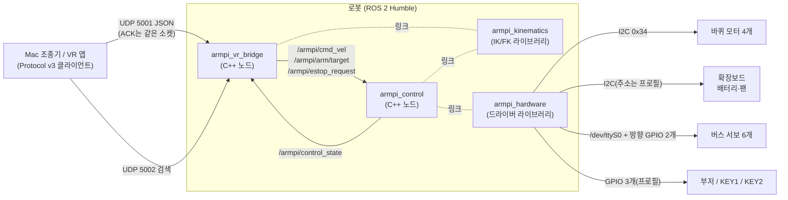
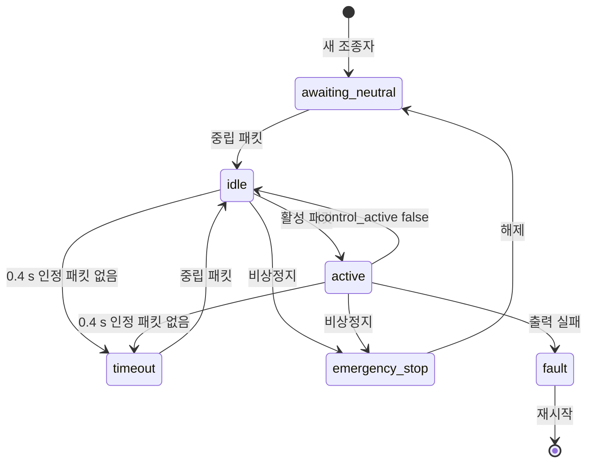
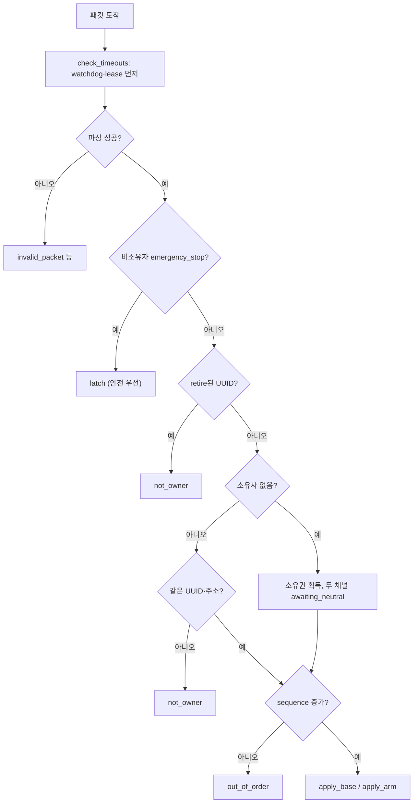

# 09. ROS 2 학습 가이드 — ArmPi 코드로 배우기

작성 2026-11-02 22:2x (Asia/Seoul). 대상: ROS 1이나 ROS 2를 처음 제대로 공부하는 팀원.
형식: 각 절을 **개념 → 이 프로젝트에서 쓴 곳 → 직접 해 보기** 순서로 쓴다.
경로는 저장소 루트 기준이다.

## 0. 먼저 읽을 것

### 0.1 표기

| 표기 | 뜻 |
|---|---|
| [코드] | 이 저장소의 소스를 읽어 확인했다 |
| [시험 로그] | (시험 기록) 의 실행 기록으로 확인했다(경로를 같이 적음) |
| [추정] | 근거가 부족하다 |
| [미확인] | 확인하지 못했다 |

### 0.2 지금 상태 (작성 시점)

- **실제 로봇에서 돌려 본 것은 0건이다.** 이 문서의 시험 수치는 모두 Mac·컨테이너 안의 루프백(127.0.0.1) 결과다.
- `armpi_vr_bridge`, `armpi_kinematics`, `armpi_interfaces`: 코드 + 컨테이너 빌드 + 단위·통합 시험 기록이 있다 [시험 로그] (시험 기록).
- `armpi_control`, `armpi_hardware`, `armpi_bringup`: 코드 + 컨테이너 빌드 + 가짜 하드웨어 시험 기록이 있다(gtest 62, 통합 16×2, 종단 3) [시험 로그] (시험 기록). 다른 작업자가 계속 고치는 중이라, 이 문서의 함수 설명은 2026-11-02 22:2x 코드 기준이다.
- `armpi_bringup`: `config/armpi.yaml`(모든 노드 매개변수), `launch/armpi.launch.py`(실기), `launch/armpi_mock.launch.py`(가짜 하드웨어)가 22:23–22:25에 생겼다 [코드].
- 하드웨어 값(I2C 주소, 서보 패킷, 메카넘 식, 링크 길이)은 `armpi.yaml` 기본값이다. 실제 로봇에서 확인한다.

### 0.3 실습 전 준비

| 장소 | 준비 |
|---|---|
| Mac | `python3`(3.8 이상). 추가 설치 없음. 가짜 로봇·조종기·적합성 시험이 표준 라이브러리만 쓴다 |
| Mac + 컨테이너 | colima + docker. 개발 이미지 `armpi-dev:humble`(= `ros:humble-ros-base-jammy` + 도구 몇 개). 스크립트가 없으면 만든다 |
| 로봇 | **ROS 2 이미지를 올린 뒤에만.** 아직 이미지 30–60단계가 끝나지 않았다. 로봇 명령은 모두 [미확인] |

로봇에서 ROS 2 명령을 쓸 때는 먼저 환경을 불러온다.

```bash
source /opt/ros/humble/setup.bash
source /opt/armpi/ros2_ws/install/setup.bash   # 이미지의 작업 공간 위치(30_workspace.sh)
```

### 0.4 전체 지도



| 패키지 | 종류 | 한 줄 설명 |
|---|---|---|
| `armpi_interfaces` | 메시지 | `ArmTarget.msg` 하나 |
| `armpi_kinematics` | 정적 라이브러리 | 팔 IK/FK. 노드 없음 |
| `armpi_vr_bridge` | 노드 + 정적 라이브러리 | Protocol v3 UDP 수신기(5001)·검색 응답(5002) |
| `armpi_control` | 노드 + 정적 라이브러리 | 비상정지 latch, 2차 watchdog, 차체·팔 제어, 상태 발행 |
| `armpi_hardware` | 정적 라이브러리 | I2C·직렬·GPIO 드라이버, 단위 변환, 가짜(mock) 장치 |
| `armpi_bringup` | launch·설정 | `config/armpi.yaml`, `launch/armpi.launch.py`·`armpi_mock.launch.py` |

---

## 1. 노드 (Node)

**개념.** 노드는 ROS 2의 실행 단위다. 토픽·서비스·타이머·파라미터를 가진다.
ROS 1의 `ros::NodeHandle` 대신 C++에서는 `rclcpp::Node`를 상속한다.

**이 프로젝트에서 쓴 곳** [코드]

| 노드 이름 | 클래스 | 실행 파일 | 파일 |
|---|---|---|---|
| `/armpi_vr_bridge` | `VrBridgeNode` | `armpi_vr_bridge_node` | `ros2_ws/src/armpi_vr_bridge/src/bridge_node.cpp`, `main.cpp` |
| `/armpi_control` | `armpi_control::ControlNode` | `armpi_control_node` | `ros2_ws/src/armpi_control/src/control_node.cpp`, `main.cpp` |

- 새 시스템은 우리 노드 + 표준 노드(rosbridge, web_video_server, usb_cam)로 이루어진다.
- `armpi_control/src/main.cpp`는 `rclcpp::spin(node)`으로 **단일 스레드 실행기**를 쓴다. 차체·팔·상태 콜백이 차례로 돌아서 공유 변수 경쟁이 없다.
- `armpi_vr_bridge`는 ROS 실행기 스레드 말고도 **자체 스레드 2개**(수신·감시)를 쓴다(10.1절).

**직접 해 보기** (로봇, [미확인])

```bash
ros2 node list                    # /armpi_vr_bridge, /armpi_control, /rosbridge_websocket ... 가 보여야 함
ros2 node info /armpi_control     # 구독·발행·서비스 목록
```

---

## 2. 토픽 (Topic)

**개념.** 발행자(publisher)가 메시지를 보내고 구독자(subscriber)가 받는다. 이름과 타입이 같아야 연결된다. ROS 1처럼 마스터(roscore)는 없다.

**이 프로젝트에서 쓴 곳** [코드] (`docs/02_ROS2_INTERFACES.md`와 소스의 `create_publisher`/`create_subscription`)

| 토픽 | 타입 | 발행 → 구독 | 주기 |
|---|---|---|---|
| `/armpi/cmd_vel` | `geometry_msgs/msg/TwistStamped` | vr_bridge → control | 20 Hz + 값이 바뀌면 즉시 |
| `/armpi/arm/target` | `armpi_interfaces/msg/ArmTarget` | vr_bridge → control | 수락마다 1회 + 팔 active 동안 20 Hz |
| `/armpi/estop_request` | `std_msgs/msg/String`(JSON) | vr_bridge → control | 이벤트 |
| `/armpi_vr_bridge/state` | `std_msgs/msg/String`(JSON) | vr_bridge → control·외부 | 2 Hz + 변화 시 |
| `/armpi/control_state` | `std_msgs/msg/String`(JSON) | control → vr_bridge | 2 Hz + 변화 시 |
| `/armpi/status` | `std_msgs/msg/String`(JSON) | control → 외부(rosbridge) | 2 Hz |
| `/armpi/battery` | `sensor_msgs/msg/BatteryState` | control → 외부 | 1 Hz |
| `/joint_states` | `sensor_msgs/msg/JointState` | control → 외부 | 20 Hz, 이름 `joint1`…`joint5`, `r_joint` |
| `/armpi/arm/joint_debug` | `sensor_msgs/msg/JointState` | 외부 → control | 디버그(세션 없을 때만) |
| `/armpi/shutdown_requested` | `std_msgs/msg/Empty` | control → `armpi-shutdown.service`(poweroff) | KEY2 길게 누름 |
| `/armpi_control/hw_state` | `std_msgs/msg/String`(JSON) | control → 진단 | 10 Hz |

- 메시지 정의: `ros2_ws/src/armpi_interfaces/msg/ArmTarget.msg`. 필드는 `header`, `active`, `x`, `y`, `z`, `pitch`, `gripper`.
- 단위는 REP‑103을 따른다. 길이 m, 각도 rad, x 앞·y 왼쪽·z 위, 회전 + 반시계.
- `~/hw_state`처럼 `~`로 시작하면 노드 이름 아래로 들어간다. 노드 이름이 `armpi_control`이므로 `/armpi_control/hw_state`가 된다.

**직접 해 보기** (로봇, [미확인])

```bash
ros2 topic list -t
ros2 topic echo --once /armpi/status
ros2 topic hz /armpi/cmd_vel          # 조종 중 약 20 Hz 기대(설계값)
```

---

## 3. QoS (통신 품질 계약)

**개념.** QoS는 발행자와 구독자가 맞춰야 하는 약속이다. 맞지 않으면 **연결 자체가 안 된다**(오류 없이 메시지가 안 오는 경우가 많다).

| 항목 | 값 | 뜻 |
|---|---|---|
| reliability | `reliable` / `best_effort` | 재전송으로 꼭 전달 / 빠르게, 잃어도 됨 |
| durability | `volatile` / `transient_local` | 지난 메시지 없음 / 나중에 붙은 구독자도 마지막 값을 받음(ROS 1 latch와 비슷) |
| history depth | `KeepLast(n)` | 큐에 몇 개까지 둘지 |

**이 프로젝트에서 쓴 곳** [코드]

- `bridge_node.cpp`의 `reliable_depth(n)`, `latched_state()` / `control_node.cpp`의 `reliable(n)`, `latched()`.
- `/armpi/control_state`, `/armpi_vr_bridge/state`: `reliable + transient_local + depth 1`. 수신기가 늦게 켜져도 제어기의 마지막 상태를 바로 받는다.
- `/armpi/cmd_vel`, `/armpi/arm/target`: `reliable + depth 1`. 오래된 명령이 쌓이지 않게 최신 1개만 둔다.
  - 그래서 노드 종료 때 정지 명령 3회를 **10 ms 간격**으로 보낸다. 간격이 없으면 depth 1 큐에서 앞 메시지가 덮인다(`bridge_node.cpp` 종료 처리 주석).
- `/armpi/estop_request`: `depth 10`. 비상정지 요청은 하나도 잃으면 안 되기 때문이다.

**직접 해 보기**

```bash
ros2 topic info -v /armpi/control_state      # Durability: TRANSIENT_LOCAL 확인
```

- 함정: `ros2 topic pub`의 기본 durability는 `volatile`이다. `transient_local` 구독자(예: 수신기가 듣는 `/armpi/control_state`)에 붙이려면 `--qos-durability transient_local --qos-reliability reliable`을 줘야 한다. 안 주면 QoS가 맞지 않아 연결되지 않는다 [추정: DDS 규칙상. 이 프로젝트에서 실행해 보지는 않음].

---

## 4. 서비스 (Service)

**개념.** 요청 → 응답 한 번. 짧게 끝나는 명령에 쓴다.

**이 프로젝트에서 쓴 곳** [코드] `control_node.cpp`의 `srv_emergency_stop`, `srv_reset_estop`, `srv_home`

| 서비스 | 타입 | 동작 |
|---|---|---|
| `/armpi/emergency_stop` | `std_srvs/srv/Trigger` | 출처 `service`로 비상정지 latch. 차체 즉시 정지, 팔은 자세 유지 |
| `/armpi/reset_estop` | `std_srvs/srv/Trigger` | 모든 출처 해제. fault는 남는다 |
| `/armpi/arm/home` | `std_srvs/srv/Trigger` | 기본 자세(1500 ms). 비상정지·fault·팔 조종 중이면 거부 |

**직접 해 보기** (로봇, [미확인])

```bash
ros2 service call /armpi/emergency_stop std_srvs/srv/Trigger
ros2 service call /armpi/reset_estop std_srvs/srv/Trigger
ros2 service call /armpi/arm/home std_srvs/srv/Trigger
```

---

## 5. 액션 (Action)

**개념.** 오래 걸리는 목표. 진행 피드백과 취소가 있다.

| 시스템 | 액션 |
|---|---|
| 새 ROS 2 | **아직 없다.** 팔은 손끝 목표 토픽(`/armpi/arm/target`)과 서비스(`/armpi/arm/home`)로만 움직인다 |

- 동작 그룹(`.d6a` 파일)과 궤적 추종은 옮기지 않았다. 옮긴다면 ROS 2 액션(`rclcpp_action`)이 맞는 도구다. 우선순위는 (공개본에 없음).

---

## 6. 파라미터 (Parameter)

**개념.** 노드별 설정값. 실행할 때 YAML로 넣는다. ROS 1의 전역 파라미터 서버는 없다.

**이 프로젝트에서 쓴 곳** [코드]

- `armpi_vr_bridge`: `ros2_ws/src/armpi_vr_bridge/config/vr_bridge.yaml` → `bridge_node.cpp`의 `declare_parameter`.
- `armpi_control`: `ros2_ws/src/armpi_bringup/config/armpi.yaml`의 `armpi_control:` 구역. 파일에 없는 값은 `control_node.cpp`의 `load_parameters()` 기본값.
- 두 노드가 **반드시 같은 값**을 써야 하는 것은 `armpi.yaml`의 `/**:` 구역(모든 노드에 적용)에 한 번만 둔다.
- 두 노드가 **같은 이름**을 쓰는 파라미터가 있다: `arm.workspace.*`, `arm.kinematics.*`, `chassis.max_*`.

**꼭 알아 둘 함정** (`armpi_vr_bridge/README_KO.md` 4절, 작성자가 확인한 것)

| 함정 | 해결 |
|---|---|
| 실수 파라미터에 `1`을 쓰면 정수라서 시작 실패 | `1.0`처럼 소수점을 쓴다 |
| Humble YAML이 `allowed_sources: []`(빈 배열)를 거부("No parameter value set") | 줄을 지우거나 `[""]` |
| 잘못된 CIDR, `lease ≤ watchdog`, 작업 공간 `min ≥ max`, 포트 사용 중 | 노드가 시작하지 않는다(종료 코드 1) |

**주의** [코드]
- 로봇 전체 실행(`armpi.launch.py`)은 `armpi.yaml` 하나로 두 노드에 같은 기구학·작업 공간을 준다.
- 수신기 단독 실행용 `vr_bridge.yaml`의 `arm.kinematics.*`·`arm.workspace.*`는 아직 **placeholder** 다. 단독 실행 때도 `params_file:=…/armpi.yaml`을 주는 것이 안전하다. 자세한 것은 `11_KNOWN_LIMITATIONS_KO.md`.
- **노드 구역에 적힌 값은 명령행 `-p`보다 우선한다.** 그래서 `hardware.mock`은 파일에 두지 않고 launch 인자 `mock:=`로만 준다(`armpi_bringup/README_KO.md` 4절).

**직접 해 보기** (로봇, [미확인])

```bash
ros2 param list /armpi_vr_bridge
ros2 param get /armpi_vr_bridge base_watchdog_sec      # 0.4
ros2 param get /armpi_control chassis.angular_sign      # 1.0 (실기에서 부호 확인 전)
```

---

## 7. launch

**개념.** 여러 노드를 한 번에 띄우는 Python 파일. 인자(`DeclareLaunchArgument`)와 파라미터 파일을 넘긴다.

**이 프로젝트에서 쓴 곳** [코드]
- `ros2_ws/src/armpi_vr_bridge/launch/vr_bridge.launch.py`: 수신기 단독 실행. 인자 `params_file`. `sigterm_timeout="5"`로 종료 시 정지 명령을 보낼 시간을 준다.
- 전체 로봇용 `armpi_bringup/launch/armpi.launch.py`: `deploy/systemd/armpi.service`가 부른다. 인자 `params_file`, `mock`, `vr_bridge`, `camera`(+ `video_device`, `pixel_format`, `image_width`, `image_height`, `framerate`), `web_video`, `rosbridge`. 설치되지 않은 선택 패키지는 경고만 남기고 건너뛴다. `usb_cam`·`web_video_server`에만 `respawn`이 있다.
- `armpi_bringup/launch/armpi_mock.launch.py`: 가짜 하드웨어 + 수신기 + rosbridge(카메라 없음).

**직접 해 보기**

```bash
ros2 launch armpi_vr_bridge vr_bridge.launch.py --show-args
ros2 launch armpi_vr_bridge vr_bridge.launch.py params_file:=/경로/vr_bridge.yaml
```

---

## 8. colcon (빌드·시험)

**개념.** ROS 2 작업 공간 빌드 도구. 패키지마다 `package.xml`(의존성)과 `CMakeLists.txt`(ament_cmake)가 있다.

| 명령·옵션 | 뜻 |
|---|---|
| `colcon build --packages-up-to armpi_vr_bridge` | 이 패키지와 의존 패키지만 빌드 |
| `--merge-install` | `install/` 아래 한 트리로 설치(이미지가 이 방식, `30_workspace.sh`) |
| `--cmake-args -DBUILD_TESTING=OFF` | 시험 빌드 끔(이미지 빌드) |
| `colcon test --packages-select armpi_vr_bridge` | 그 패키지 시험만 |
| `colcon test-result --verbose` | 실패 목록 출력 |

**이 프로젝트에서 쓴 곳**
- `scripts/armpi_dev_build_and_test.sh [unit|integration|all]`: 컨테이너(`--network none`)에서 `armpi_vr_bridge`까지 빌드·시험. 결과는 (시험 기록).
- 정적 라이브러리 + 얇은 노드 구조: `armpi_vr_bridge_core`, `armpi_control_core`, `armpi_hardware`, `armpi_kinematics`는 ROS 없이 gtest로 시험한다.

**결과 예** [시험 로그] (시험 기록)
- 빌드 3패키지(`armpi_interfaces`, `armpi_kinematics`, `armpi_vr_bridge`), 컴파일 경고 0.
- gtest 110개 실패 0: `test_strict_json` 12, `test_protocol` 25, `test_session` 44, `test_discovery` 10, `test_source_filter` 7, `test_udp_server` 12.
- 통합 시험 10개 통과(노드 실행 + UDP ↔ ROS 토픽, 가짜 `control_state`).
- `armpi_kinematics`의 gtest는 이 스크립트가 돌리지 않는다. (시험 기록) 안에 그 실행 로그는 없다 [미확인].
- `armpi_control`·`armpi_hardware`의 gtest 파일은 있다(`test_safety`, `test_chassis`, `test_arm_controller`, `test_mini_json`, `test_conversions`, `test_servo_protocol`, `test_devices`). 실행 로그는 미확인이다.

---

## 9. DDS, ROS_DOMAIN_ID, ROS_LOCALHOST_ONLY

**개념.**
- ROS 2 노드는 DDS로 서로를 **자동으로** 찾는다(UDP 멀티캐스트, 포트 7400번대).
- `ROS_DOMAIN_ID`가 같은 노드끼리만 보인다.
- `ROS_LOCALHOST_ONLY=1`이면 같은 컴퓨터 안에서만 통신한다.

**이 프로젝트에서 쓴 곳** [코드]

| 위치 | 값 | 이유 |
|---|---|---|
| `deploy/systemd/armpi.service` | `ROS_DOMAIN_ID=0`, `ROS_LOCALHOST_ONLY=0` | 같은 망의 PC ROS 2 도구 허용 |
| 통합 시험 | `ROS_LOCALHOST_ONLY=1` | 시험 패킷이 밖으로 새지 않게 |

- 외부 장치(Mac·VR)는 DDS를 쓰지 않는다. UDP 5001(Protocol v3)과 rosbridge 9090(WebSocket JSON)으로 들어온다. 통신 전체는 `07_COMMUNICATION_ARCHITECTURE_KO.md`.
- 공용 망(1순위 와이파이)에서 DDS를 열어 두면 같은 망의 누구나 토픽을 볼 수 있다. 보안 한계는 `11_KNOWN_LIMITATIONS_KO.md`.

---

## 10. rclcpp로 본 우리 노드 구조

공통 원칙: **ROS와 무관한 순수 로직을 라이브러리로 떼고, 시계(`now`)를 인자로 받는다.** 그래서 가짜 시계로 시간 규칙을 시험할 수 있다.

### 10.1 `armpi_vr_bridge` [코드 + 시험 로그]

| 파일 | 핵심 함수 | 하는 일 |
|---|---|---|
| `src/strict_json.cpp` | (파서) | 중복 키·NaN·정수/실수 구분·UTF-8 검사. `sequence: 2.0`을 거부해야 해서 직접 만들었다 |
| `src/protocol.cpp` | `parse_packet`, `encode_ack`, `canonical_uuid` | v3 패킷 해석(`command` 8필드, `arm_command` 10필드, 이벤트 4필드), ACK 8필드 생성 |
| `src/session.cpp` | `Session::handle_datagram`, `check_timeouts`, `set_control_state`, `apply_base`, `apply_arm` | 세션·채널 상태기계(15절) |
| `src/udp_server.cpp` | `UdpServer::rx_loop`, `monitor_loop`, `handle`, `send_to` | 소켓·스레드 |
| `src/discovery.cpp` | `DiscoveryServer::loop` | `ARMPI_DISCOVER/1` → `ARMPI_HERE/1 … |3`, 초당 20회 제한 |
| `src/net.cpp` | | IPv4·CIDR(`allowed_sources`) |
| `src/bridge_node.cpp` | `VrBridgeNode` | 발행·구독·파라미터·종료 정지 3회 |

스레드 3개:

```text
수신 스레드 rx_loop      : poll(20 ms) → recvfrom → 출처 필터 → Session 처리(뮤텍스 안)
                           → 출력 콜백(뮤텍스 밖) → ACK 송신
                           패킷이 없어도 매번 watchdog·lease·control_state 나이를 검사
감시 스레드 monitor_loop : 수신 루프 heartbeat가 0.5 s 넘게 멈추면 세션 정지(새 중립 요구)
                           수신 스레드가 끝났으면 fault latch
ROS 실행기 스레드        : 50 Hz 만료 검사 타이머, 20 Hz 발행 타이머, /armpi/control_state 구독
```

- `Session::handle_datagram`은 **패킷을 적용하기 전에** `check_timeouts(now)`를 먼저 부른다. 만료 직후에 온 패킷이 만료를 지우지 못하게 하기 위해서다.
- 콜백을 뮤텍스 밖에서 부르는 이유: 콜백이 막혀도 감시 스레드가 세션을 멈출 수 있게(시험 `StallMonitorStopsWhileReceiveThreadIsBlocked`).

### 10.2 `armpi_control` [코드 + 시험 로그 (시험 기록)]

| 구성 | 함수·클래스 | 하는 일 |
|---|---|---|
| 콜백 | `on_cmd_vel` | 유한값·`header.stamp` 나이(0.5 s 이하) 검사 → `ChassisController::on_command`. 정지(0)는 즉시 출력 |
| | `on_arm_target` | `ArmController::on_target` 결과(수락·거부 사유)를 기록 |
| | `on_estop_request` | JSON `{"source","latch"}` → 출처별 latch/해제 |
| | `on_joint_debug` | UDP 조종 세션·비상정지·fault·home 중이면 무시 |
| | `on_bridge_state` | 수신기 상태(소유자, 채널 상태) 저장 |
| 타이머 | `chassis_tick` (50 Hz) | watchdog 0.6 s → 가속 제한 → 메카넘 펄스 → I2C 쓰기 |
| | `arm_tick` (50 Hz) | 손끝 보간 → IK → 관절 속도 제한 → 서보 명령(40 ms) |
| | `misc_tick` (50 Hz) | 부저 끄기, KEY1·KEY2 읽기 |
| | `status_tick`, `joint_states_tick`, `battery_tick`, `hw_state_tick` | 상태 발행 |

안전 부품(`include/armpi_control/safety.hpp`):

| 클래스 | 규칙 |
|---|---|
| `EstopLatch` | 출처별 latch. `release(출처)`는 그 출처만, `reset_all()`은 전부. `service`·`button` 출처는 토픽으로 못 풀고 `/armpi/reset_estop`으로만 푼다 |
| `Watchdog` | `feed(now)`, `expired(now)`. 한 번도 안 먹였으면 만료 상태 |
| `ButtonDetector` | 50 ms debounce, 누름·뗌·길게 누름. 시작 때 이미 눌려 있으면 한 번 뗄 때까지 무시 |

- KEY1 누름 → 비상정지(출처 `button`). KEY2 2 s → `/armpi/shutdown_requested` 발행 → `deploy/systemd/armpi-shutdown.service`가 받아 `systemctl poweroff` [코드, 실기 미확인].
- KEY1은 비상정지 버튼이다.
- 팔 토크 해제(`LOAD_OR_UNLOAD` 0)는 **어디서도 보내지 않는다.** 비상정지·timeout 때 팔은 그 자리에서 버틴다.

`ChassisController`(`chassis_controller.cpp`):
- `slew_axis`: 가속만 제한한다. 감속·0은 즉시. 부호가 바뀌면 먼저 0으로 간다.
- 기본 가속 제한 0.6 m/s², 4.0 rad/s².
- 바퀴 펄스가 ±100을 넘으면 네 바퀴를 같은 비율로 줄인다(`limit_wheel_pulses`).

`ArmController`(`arm_controller.cpp`):
- `home()`: 서보 ID 1–6 = 하드웨어 프로필 `arm.home_servo_values`를 1500 ms 동안. 보간 상태를 그 자세의 FK로 맞춘다.
- `on_target()`: 작업 공간 → IK → (비상정지·초기화·home 중 확인) 순으로 판정.
- `tick()`: `interpolate_step`(직선 0.15 m/s, pitch 1.0 rad/s, 그리퍼 1.0/s) → IK → `step_joints`(관절 2.0 rad/s) → 바뀐 서보만 `MOVE_TIME_WRITE`.
- 보간 중 IK가 실패하면 직전 자세를 유지한다(`ik_blocked`).

### 10.3 `armpi_hardware` [코드 + 시험 로그 (시험 기록)]

| 파일 | 함수·클래스 | 하는 일 |
|---|---|---|
| `conversions.cpp` | `twist_to_polar`, `mecanum_motor_pulses`, `limit_wheel_pulses` | 11절 |
| | `joint_to_servo`, `servo_to_joint`, `gripper_to_servo` | 관절각 ↔ 서보값 |
| `servo_protocol.cpp` | `checksum`, `encode`, `encode_move_time_write`, `parse_packet`, `parse_response` | 13절 |
| `devices.cpp` | `I2cMotorBoard`, `I2cExpansionBoard`, `HalfDuplexServoBus` | 장치 계층 |
| `linux_i2c_bus.cpp` | `open_linux_i2c_bus` | `/dev/i2c-1`에 `ioctl(I2C_RDWR)` |
| `linux_serial_port.cpp` | `open_linux_serial_port` | termios raw 8N1, `tcdrain`, `tcflush` |
| `gpiod_gpio.cpp` | `open_gpiod_gpio` | libgpiod v1.6 C++(`gpiod::chip`, `gpiod::line`) |
| `mock.cpp` | `MockMotorBoard`, `MockServoBus`, `MockGpio` … | 실제 장치 없이 실행. `set_fail(true)`로 실패 흉내 |
| `hardware.cpp` | `make_mock_hardware`, `open_real_hardware` | 장치 묶음 만들기 |

- 인터페이스(`MotorBoard`, `ServoBus`, `Gpio`, `I2cBus`, `SerialPort`)를 두고 실제·가짜 구현을 바꿔 끼운다. 이것이 Mac에서 시험할 수 있는 이유다.
- libgpiod가 없으면 실제 GPIO 없이 빌드된다(CMake 경고). 가짜 하드웨어는 그래도 동작한다.

### 10.4 `armpi_kinematics` [코드]

- `include/armpi_kinematics/arm_kinematics.hpp`: `Params`, `Pose`, `JointAngles`, `IkStatus`(`kOk`, `kOutOfReach`, `kJointLimit`, `kInvalid`), `ArmKinematics::inverse/forward`, `Workspace`, `inside`.
- 수신기(목표 판정)와 제어기(실제 구동)가 **같은 라이브러리**를 링크한다. 설정만 같으면 판정도 같다.

---

## 11. 메카넘 차체 운동학

### 11.1 개념

메카넘 바퀴는 둘레에 45° 롤러가 붙어 있다. 네 바퀴 속도를 조합하면 앞뒤·옆·회전을 동시에 할 수 있다.

### 11.2 메카넘 식

| 상수 | 키(하드웨어 프로필) |
|---|---|
| a (앞뒤 축 반거리, mm) | `chassis.a_mm` |
| b (좌우 바퀴 반거리, mm) | `chassis.b_mm` |
| 바퀴 지름 D (mm) | `chassis.wheel_diameter_mm` |
| 바퀴 1회전 펄스 N | `chassis.pulse_per_cycle` |

실제 값은 로봇마다 다르고 이 저장소에 없다. 아래 계산 예는 **시험용 프로필 값**(`config/test_hardware_profile.yaml`: a 100, b 90, D 100, N 6000, 실제 로봇 값 아님)으로 한다.

입력(극좌표): `velocity`(mm/s), `direction`(도, 0° = 오른쪽, 90° = 앞), `angular`(rad/s).

```text
1) V = −velocity,  W = −angular
2) vx = V·cos(dir),  vy = V·sin(dir),  vp = W·(a+b)        [mm/s]
3) v1 = vy − vx + vp,  v2 = vy + vx − vp,  v3 = vy − vx − vp,  v4 = vy + vx + vp
4) 모터 1..4 = [−v1, v4, v2, −v3]
5) 펄스/10 ms = v / (π·D) · N · 0.01  → 0 쪽으로 자름(int)
```

- 5번의 뜻: `v/(π·D)` = 초당 바퀴 회전수. × N = 초당 펄스. × 0.01 = 10 ms당 펄스.
- 시험용 값이면 1 mm/s ≈ 0.1910 펄스/10 ms.

### 11.3 ROS 2 `cmd_vel` → 극좌표 (`conversions.cpp` `twist_to_polar`) [코드]

```text
velocity  = hypot(vx, vy) · 1000                 [m/s → mm/s]
direction = atan2(vx, −vy)  (도)                  [앞 = 90°, 왼쪽 = 180°]
angular   = angular_sign · wz                     [angular_sign 기본 1.0, 실기에서 확인]
```

### 11.4 손으로 계산해 보기 (시험용 프로필 값, 직접 계산)

**예 1: 앞으로 0.05 m/s** (`vx=0.05, vy=0, wz=0`)
1. velocity = 50 mm/s, direction = atan2(0.05, 0) = 90°
2. V = −50 → vx' = −50·cos90° ≈ 0, vy' = −50·sin90° = −50, vp = 0
3. v1 = v2 = v3 = v4 = −50
4. 모터 = [−v1, v4, v2, −v3] = [50, −50, −50, 50] mm/s
5. 50 / (π·100) · 6000 · 0.01 = 9.549 → **[9, −9, −9, 9]** 펄스/10 ms

**예 2: 왼쪽으로 0.05 m/s** (`vy=0.05`) → direction 180° → 모터 [50, 50, 50, 50] → **[9, 9, 9, 9]**

**예 3: 좌회전 0.6 rad/s** (`wz=0.6`) → vp = −0.6 · 190 = −114 → 모터 [114, −114, 114, −114] → **[21, −21, 21, −21]**

- 같은 시험용 값으로 앞뒤 상한 0.25 m/s(2026-11-04 결정, 바퀴 방향 실기 시험 전)는 47 펄스/10 ms다. 실제 펄스는 로봇의 차체 치수·엔코더 값에 따라 다르다. 앞뒤·좌우·회전을 동시에 크게 주면 바퀴 상한 100을 넘을 수 있고, 그때는 네 바퀴를 같은 비율로 줄인다.
- **모터 번호가 어느 바퀴인지, + 펄스가 어느 방향으로 도는지는 실기 확인 전이다** [미확인]. 시험 절차는 `10_HARDWARE_TEST_PLAN_KO.md`.

---

## 12. 팔 역기구학(IK)·정기구학(FK)

### 12.1 좌표와 정의 (`ros2_ws/src/armpi_bringup/config/armpi.yaml`, 관절 기준·범위는 하드웨어 프로필)

- 좌표계 `armpi_arm_base`(REP‑103): x 앞, y 왼쪽, z 위, 원점은 팔 바닥.
- `pitch`: 손 링크가 수평 앞에서 이루는 각. 0 = 수평, −π/2 = 아래, + = 위.
- 링크: 바닥 → 어깨 축 높이 `h = 0.064605`, 위팔 `L1 = 0.10048`, 아래팔 `L2 = 0.094714`, 손(그리퍼 끝까지) `Lh = 0.16331` (m). Hiwonder 공개 ArmPi FPV 기구학 값이다(ArmPi Pro 실측 확인 필요).
- 관절: joint1 베이스 회전, joint2 어깨, joint3 팔꿈치, joint4 손목 pitch. joint5(손목 회전)와 그리퍼는 IK 대상이 아니다.

### 12.2 IK 순서 (`arm_kinematics.cpp` `ArmKinematics::inverse`) [코드]

```text
1) 베이스 회전:  r = hypot(x, y),  yaw = atan2(y, x)                → joint1
2) 손목 중심(팔 평면):  rw = r − Lh·cos(pitch)
                         zw = (z − h) − Lh·sin(pitch)
3) 코사인 법칙:  cos q3 = (rw² + zw² − L1² − L2²) / (2·L1·L2)
                 |cos q3| > 1 이면 닿지 않음(kOutOfReach)
4) elbow-up(팔꿈치 위):  q3 = −acos(cos q3)
5) 어깨:  q2 = atan2(zw, rw) − atan2(L2·sin q3, L1 + L2·cos q3)
6) 손목:  q4 = pitch − q2 − q3
7) 관절 기준:  joint = sign·q + offset   (sign·offset 은 하드웨어 프로필 arm.kinematics.j*_sign/offset)
8) 관절 범위 검사 → 넘으면 kJointLimit
```

- **코사인 법칙**: 삼각형 두 변(L1, L2)과 끼인각으로 세 번째 변(어깨→손목 거리)을 정한다. 거꾸로 거리에서 끼인각을 구한 것이 3번이다.
- **elbow-up**: 같은 손목 위치에 팔꿈치가 위·아래 두 해가 있다. 위쪽 해만 쓴다.

추가 거부 조건:

| 조건 | 상태 |
|---|---|
| 손목 관절축 높이(`zw + h`)가 0보다 낮음 | `kOutOfReach` |
| 팔꿈치 굽힘이 0.05 rad보다 작음(거의 일자) | `kOutOfReach` |

관절 범위: joint1·joint3 ±120°(Hiwonder 공개 ArmPi FPV 기구학 값). joint2·joint4 는 하드웨어 프로필(`arm.kinematics.joint_min/max`)에서 받는다.

### 12.3 FK 예: 기본 자세 손끝 목표 (직접 계산)

기하 각도(관절 기준을 빼고 수평에서 잰 링크 각)로 계산한다. 관절값·서보값으로 바꾸는 규칙은 하드웨어 프로필에 있다.

```text
어깨 링크 각(수평 기준)  a2 = 120°
아래팔 각              a3 = 42°
손 각                  a4 = −58.8°   → pitch = −1.0263 rad
r = L1·cos120° + L2·cos42° + Lh·cos(−58.8°) = −0.05024 + 0.07039 + 0.08460 = 0.1047 m
z = h + L1·sin120° + L2·sin42° + Lh·sin(−58.8°)
  = 0.064605 + 0.08702 + 0.06338 − 0.13969 = 0.0753 m
```

결과: **x 0.1047, y 0, z 0.0753, pitch −1.0263**(`armpi.yaml` `arm.home`). 하드웨어 프로필의 기본 자세 서보값은 이 손끝이 되도록 맞춘다. `ArmController::validate()`가 시작할 때 그 자세의 FK → IK가 풀리는지 확인한다 [코드].

### 12.4 IK 예: 손으로 풀어 보기

목표 (x, y, z, pitch) = (0.169, 0, 0.12, −0.7854) (Mac 조종기 시험에서 쓴 값):

```text
rw = 0.169 − 0.16331·cos(−0.7854) = 0.05352
zw = (0.12 − 0.064605) − 0.16331·sin(−0.7854) = 0.17087
cos q3 = (0.05352² + 0.17087² − 0.10048² − 0.094714²) / (2·0.10048·0.094714) = 0.68275
q3 = −46.94°,  q2 = 95.34°,  q4 = −93.40°
joint = sign·q + offset(프로필) → 서보값 = 500 + 방향·joint·1000/240(프로필의 관절 ↔ 서보 배정)
```

### 12.5 관절각 ↔ 서보값 (`conversions.cpp` `joint_to_servo`)

```text
서보값 = 500 + 방향 · 각도(도) · 1000/240     (방향 ±1 은 프로필 arm.joint_directions, 0..1000으로 자름)
예) 방향 +1, 30° → 500 + 125 = 625,  방향 −1, −30° → 500 + 125 = 625
```

- 그리퍼: 0 = 열림(프로필 `arm.gripper.open_value`), 1 = 닫힘(`close_value`). `gripper_to_servo`.

### 12.6 검증 수준

  - FK → IK → FK 왕복 gtest가 `armpi_kinematics/test/test_arm_kinematics.cpp`에 있다(공개 링크 길이 + 시험용 관절 기준) [코드].
- 이것은 **소프트웨어가 같은 값을 낸다**는 뜻이다. 실제 손끝 위치 정확도는 측정 전이다 [미확인].
- 이 팔은 손이 길어서(0.163 m) **아래를 향한 자세의 도달 범위가 좁다.** pitch −90°는 낮은 높이의 좁은 거리에서만 풀린다(범위는 관절 범위에 따라 다름). 그래서 문서 01의 예시 `(0.15, 0, 0.12, −π/2)`는 IK가 풀리지 않는다. VR 매핑에서의 의미는 `08_VR_HANDOFF_KO.md`.

---

## 13. 버스 서보 직렬 패킷과 반이중

### 13.1 패킷 (`servo_protocol.cpp`, 근거 Hiwonder 버스 서보 통신 규격)

```text
0x55 0x55 ID LEN CMD P1 … Pn CHK
LEN = 3 + n
CHK = 255 − ((ID + LEN + CMD + ΣP) mod 256)
```

| 명령 | 번호 | 인자 |
|---|---|---|
| `MOVE_TIME_WRITE` | 1 | 위치 lo, hi(0–1000), 시간 lo, hi(0–30000 ms) |
| `MOVE_STOP` | 12 | |
| `TEMP_READ` | 26 | 응답 1 B(°C) |
| `VIN_READ` | 27 | 응답 2 B(mV) |
| `POS_READ` | 28 | 응답 2 B |
| `LOAD_OR_UNLOAD_WRITE` | 31 | 1 = 토크 켬, 0 = 끔(우리 코드는 0을 안 보냄) |

### 13.2 체크섬 손으로 계산 (직접 계산, scratchpad 검산)

서보 1을 위치 500, 1000 ms로:

```text
위치 500  = 0x01F4 → P1=0xF4, P2=0x01   (little-endian: 낮은 바이트 먼저)
시간 1000 = 0x03E8 → P3=0xE8, P4=0x03
LEN = 3 + 4 = 7
합 = 1 + 7 + 1 + 0xF4(244) + 1 + 0xE8(232) + 3 = 489
489 mod 256 = 233 → CHK = 255 − 233 = 22 = 0x16
패킷: 55 55 01 07 01 F4 01 E8 03 16
```

더 해 보기:

| 내용 | 패킷 |
|---|---|
| 서보 6, 위치 500, 1500 ms | `55 55 06 07 01 F4 01 DC 05 1B` |
| 서보 5, 위치 700, 40 ms | `55 55 05 07 01 BC 02 28 00 0C` |
| 서보 3 위치 읽기 요청 | `55 55 03 03 1C DD` |

### 13.3 반이중 방향 전환 (`devices.cpp` `HalfDuplexServoBus`)

- 서보 6개가 **선 하나**로 보내고 받는다(반이중). 동시에 말하면 충돌한다.
- 그래서 GPIO 두 개로 방향 버퍼를 바꾼다: 보낼 때 `TX_CON=1, RX_CON=0`, 받을 때 반대(핀 번호는 하드웨어 프로필 `hardware.servo_tx_con_bcm`·`servo_rx_con_bcm`).

```text
write_packet_locked:  set_tx → pre_write_delay_us 대기 → write_all → tcdrain(마지막 바이트가 다 나갈 때까지) → post_write_delay_us 대기
read_locked:          요청 쓰기 → set_rx → flush_input → read_turnaround_delay_us 대기 → 4 B 읽기(머리 55 55 확인)
                      → LEN−1 B 더 읽기 → set_tx(항상 쓰기 모드로 복귀) → parse_response(ID·명령·체크섬)
```

- `tcdrain`은 추가한 단계다. 바이트가 다 나가기 전에 방향을 바꾸면 끝 바이트가 잘릴 수 있어 넣었다 [코드 주석]. 실제 타이밍이 맞는지는 실기 확인 전이다 [미확인].
- 제어기의 팔 상태는 기본으로 명령값이다(`servo.read_position: false`, 상태의 `position_source: "commanded"`).
- 직렬 포트 `/dev/ttyS0`에 리눅스 콘솔이 섞이면 서보가 이상한 바이트를 받는다. 그래서 이미지의 커널 명령줄에 `console=serial0`이 없고 `serial-getty@ttyS0`를 막았다 [코드: (이미지 빌드 스크립트, 공개본에 없음)].

---

## 14. I2C 기초

**개념.**
- 선 두 개(SDA 데이터, SCL 시계)에 장치 여러 개가 7비트 **주소**로 붙는다.
- 보통 "레지스터 번호를 쓰고 → 값을 쓰거나 읽는다".
- 한 번의 START…STOP을 **트랜잭션**이라 한다.

**이 프로젝트에서 쓴 곳** [코드, 근거 `armpi.yaml`·하드웨어 프로필]

| 장치 | 주소 | 쓰기·읽기 |
|---|---|---|
| 바퀴 모터 보드 | 0x34 | 초기화: `[20, 3]`(레지스터 20 ← 모터 종류 3). 속도: `[51, m1, m2, m3, m4]`(signed int8) |
| 확장보드 | 프로필 `hardware.expansion_board_address` | 배터리: `[battery_register]` 쓰기 트랜잭션 → 2 B 읽기 트랜잭션, little-endian mV. 팬: `dc_motor_register`(+i−1)에 signed int8(부호 `dc_motor_sign`) |

- 배터리 예: 7358 mV = 0x1CBE → 받는 바이트 `BE 1C` → `0xBE + 0x1C·256 = 7358`.
- 버스 속도는 로봇 이미지의 부트 설정을 따른다(이 저장소에서 정하지 않음).
- `linux_i2c_bus.cpp`는 `ioctl(fd, I2C_RDWR, …)`로 `i2c_msg`를 보낸다. 여러 스레드가 써도 되게 내부 뮤텍스를 쓴다.

**직접 해 보기** (로봇, 실기에서만, [미확인])

```bash
sudo i2cdetect -y -r 1      # 주소 응답만 본다(레지스터에 값을 쓰지 않음). 0x34 와 프로필의 확장보드 주소가 보이면 기대와 같음
```

---

## 15. Protocol v3 상태기계

전체 규칙: `docs/01_PROTOCOL_V3_SPEC.md`. 구현: `session.cpp`(로봇), `protocol_v3/mock_robot.py`(가짜 로봇), `protocol_v3/armpi_v3_client.py`(클라이언트).

### 15.1 세션 하나 + 채널 둘

| 단위 | 가진 것 |
|---|---|
| 세션(1개) | 소유자(UUID + IP·포트), `sequence`, lease 1.0 s, retire 목록(최대 1024), 비상정지 latch |
| 차체 채널 | 중립 확인, watchdog 0.4 s, 상태 |
| 팔 채널 | 중립 확인, watchdog 0.4 s, 상태 |

- `command`·이벤트 → 차체 채널, `arm_command` → 팔 채널. ACK의 `state`는 그 채널의 상태다.
- watchdog은 그 채널에서 **인정된** 패킷만 갱신한다. 거부(`workspace_limit`, `ik_unreachable` 포함)·이벤트는 갱신하지 않는다.
- lease는 소유자의 새 번호 패킷이면 어느 채널이든 갱신한다.

### 15.2 채널 상태 (`Session::channel_state`) [코드]

판정 순서: `fault` > `emergency_stop` > `timeout` > `awaiting_neutral` > `active`/`idle`.



| 채널 | timeout 때 | 비상정지 때 |
|---|---|---|
| 차체 | 즉시 정지 | 즉시 정지 |
| 팔 | 현재 보간 위치에서 정지, **토크 유지** | 같음 |

### 15.3 세션 흐름 (`Session::handle_current`) [코드]



`apply_arm`의 활성 명령 판정 순서: `fault` → `emergency_stop` → `neutral_required` → 제어기 게이트(`not_owner`) → 작업 공간(`workspace_limit`) → IK(`ik_unreachable`) → 수락.

### 15.4 제어기 게이트

- 수신기는 `/armpi/control_state`를 듣는다. 못 받았거나 2.0 s 넘게 오래됐거나 `udp_allowed:false`면 활성 명령을 `not_owner`로 거부한다. 중립은 받는다.
- 제어기가 `estop:true`면 UDP 해제를 보내도 비상정지가 유지된다(UDP latch **또는** 제어기 estop).

---

## 16. 디버깅 명령 모음

로봇 이미지에는 GUI(rqt)가 없다(ros-base). 대신 아래를 쓴다. 로봇 명령은 모두 [미확인](이미지 미완성).

### 16.1 ROS 2 CLI

| 목적 | 명령 |
|---|---|
| 노드·토픽 목록 | `ros2 node list`, `ros2 topic list -t` |
| 값 한 번 보기 | `ros2 topic echo --once /armpi/status` |
| 계속 보기 | `ros2 topic echo /armpi/control_state` |
| 주기 | `ros2 topic hz /joint_states` (설계 20 Hz) |
| QoS·연결 수 | `ros2 topic info -v /armpi/cmd_vel` |
| 파라미터 | `ros2 param list /armpi_control`, `ros2 param get /armpi_vr_bridge lease_sec` |
| 서비스 | `ros2 service list`, `ros2 service call /armpi/emergency_stop std_srvs/srv/Trigger` |
| 수신기 상태 | `ros2 topic echo /armpi_vr_bridge/state` (소유자·채널 상태·패킷 카운터) |
| 장치 출력 | `ros2 topic echo /armpi_control/hw_state` (바퀴 펄스, 서보 명령값, 쓰기 실패 수) |

관절 디버그(UDP 조종 세션이 없을 때만 적용, **팔이 움직임**):

```bash
ros2 topic pub --once /armpi/arm/joint_debug sensor_msgs/msg/JointState "{name: ['joint1'], position: [0.2]}"
```

비상정지 요청 토픽을 직접 보내기:

```bash
ros2 topic pub --once /armpi/estop_request std_msgs/msg/String "{data: '{\"source\":\"test\",\"latch\":true}'}"
ros2 topic pub --once /armpi/estop_request std_msgs/msg/String "{data: '{\"source\":\"test\",\"latch\":false}'}"
```

### 16.2 rqt 대신 쓸 것

| 도구 | 보는 것 |
|---|---|
| Mac 조종기 화면(`clients/mac_controller/`, `04_APPS_HOWTO_KO.md`) | 채널 상태, 마지막 reason, ACK 지연, 배터리, 팔 목표·현재값 |
| rosbridge 9090 | Mac 조종기가 `/armpi/status`를 구독해 표시 |
| web_video_server 8080 | `http://<IP>:8080/` 카메라 토픽 목록, `…/stream?topic=/usb_cam/image_raw&type=ros_compressed&qos_profile=sensor_data` |
| `ros2 topic echo` | 위 표 |

### 16.3 시스템

| 목적 | 명령 |
|---|---|
| 서비스 상태 | `systemctl status armpi.service` |
| 로그 따라가기 | `journalctl -u armpi.service -f` |
| 이번 부팅 로그 | `journalctl -u armpi.service -b` |
| 다시 시작 | `sudo systemctl restart armpi.service` |
| 네트워크 대체 AP | `journalctl -u armpi-net-fallback.service -b`, `nmcli device` |
| 카메라 | `v4l2-ctl --list-devices`, `v4l2-ctl -d /dev/video0 --list-formats-ext` |
| I2C | `sudo i2cdetect -y -r 1` (14절) |

- 수신기는 10초마다 수신 통계를 로그에 남긴다(`stats_log_period_sec`). 끊김·지연 튐을 볼 때 쓴다.

---

## 17. 실습 과제 (정답 힌트 포함)

순서대로 하면 된다. 1–5는 Mac만으로 된다. **로봇에 접속하지 않는다.**

### 과제 1. 가짜 로봇과 적합성 시험 (Mac)

```bash
cd ArmPro_Cpp_ROS2
python3 protocol_v3/mock_robot.py --bind 127.0.0.1                        # 터미널 1
python3 protocol_v3/conformance_test.py --host 127.0.0.1 -v              # 터미널 2
```

- 질문: 건너뛴 시험은 왜 건너뛰었나?
- 힌트: `--condition`(`control_missing`, `udp_blocked`, `fault`, `source_blocked`) 전용 시험과 `--interpretation` 시험이 기본 조건에서 빠진다. 기록된 결과는 통과 44 / 건너뜀 9였다 [시험 로그] (시험 기록).

### 과제 2. 클라이언트로 검색·smoke (Mac)

```bash
python3 protocol_v3/armpi_v3_client.py --discover --discover-target 127.0.0.1
python3 protocol_v3/armpi_v3_client.py --robot 127.0.0.1 --smoke
```

- 질문: 검색 응답 문자열의 마지막 숫자 `3`은 무엇인가?
- 힌트: 프로토콜 버전. 응답은 출발 포트가 5002여야 받아들인다(`parse_discovery_reply`, `discover`).

### 과제 3. 상태기계를 손으로 건드려 보기 (Mac)

가짜 로봇을 띄운 채 아래를 파이썬으로 보낸다.

```python
import json, socket, uuid
s = socket.socket(socket.AF_INET, socket.SOCK_DGRAM); s.settimeout(0.5)
cid = str(uuid.uuid4())
def send(obj):
    s.sendto(json.dumps(obj).encode(), ("127.0.0.1", 5001)); print(s.recv(2048).decode())
base = {"protocol": 3, "type": "command", "client_id": cid}
send({**base, "sequence": 1, "control_active": True, "forward": 0.3, "strafe": 0.0, "turn": 0.0})   # ①
send({**base, "sequence": 2, "control_active": False, "forward": 0.0, "strafe": 0.0, "turn": 0.0})  # ②
send({**base, "sequence": 3, "control_active": True, "forward": 0.3, "strafe": 0.0, "turn": 0.0})   # ③
send({**base, "sequence": 3, "control_active": True, "forward": 0.3, "strafe": 0.0, "turn": 0.0})   # ④
```

- 질문: ①–④의 `reason`과 `state`를 예상해 보라.
- 힌트: ① `neutral_required`/`awaiting_neutral` ② `ok`/`idle` ③ `ok`/`active` ④ `out_of_order`. 0.4 s 넘게 기다린 뒤 보내면 `timeout`도 볼 수 있다.
- 더 해 보기: `"sequence": 5.0`(실수)이나 필드 하나를 빼서 `invalid_packet`을 보라.

### 과제 4. 컨테이너에서 빌드·gtest (Mac + colima)

```bash
scripts/armpi_dev_build_and_test.sh unit
cat work/logs/vr_bridge_unit_<시각>/unit_summary.txt
```

- 질문: 시험은 왜 `--network none` 컨테이너에서 도나?
- 힌트: 시험 패킷이 실제 망·로봇으로 새지 않게. 기록상 gtest 110개, 실패 0이었다 [시험 로그] (시험 기록).

### 과제 5. 메카넘·체크섬·IK를 손으로 (종이)

- 11.4절 예 1–3, 13.2절 패킷, 12.4절 IK를 계산기로 다시 풀어 본다.
- 정답은 각 절에 있다. 틀리면 단위(mm/s vs m/s, 도 vs rad)부터 의심한다.

### 과제 6. 가짜 하드웨어로 제어 노드 띄우기 (컨테이너)

같은 흐름을 자동으로 도는 스크립트: `ros2_ws/src/armpi_bringup/test/dev_build_and_test.sh all` (결과 예: (시험 기록)). 아래는 손으로 따라 하는 절차다(이 문서 작성자가 손으로 돌려 보지는 않았다).

```bash
# 컨테이너 안(예: armpi-dev:humble, --network none). 소스를 /tmp/ws/src 로 복사한 뒤
cd /tmp/ws && source /opt/ros/humble/setup.bash
colcon build --merge-install --packages-up-to armpi_control
source install/setup.bash
ros2 run armpi_control armpi_control_node --ros-args -p hardware.mock:=true &
ros2 topic echo --once /armpi/status
ros2 topic echo /armpi_control/hw_state
```

가짜 장치 조작(`~/mock_cmd` = `/armpi_control/mock_cmd`, mock일 때만 있음):

```bash
ros2 topic pub --once /armpi_control/mock_cmd std_msgs/msg/String "{data: 'gpio 25 0'}"    # KEY1 누름 → 비상정지(button). 25 = 시험용 프로필의 key1_bcm
ros2 topic pub --once /armpi_control/mock_cmd std_msgs/msg/String "{data: 'gpio 25 1'}"    # KEY1 뗌
ros2 service call /armpi/reset_estop std_srvs/srv/Trigger
ros2 topic pub --once /armpi_control/mock_cmd std_msgs/msg/String "{data: 'fail i2c 1'}"   # 바퀴 쓰기 실패 주입
ros2 topic pub --once /armpi_control/mock_cmd std_msgs/msg/String "{data: 'battery 6500'}" # 저전압
```

- 질문 1: `fail i2c 1` 뒤 `/armpi/control_state`는 어떻게 되나?
  - 힌트: 바퀴 쓰기가 연속 5회(`hardware.fault_threshold`) 실패하면 `fault:true`. fault는 `reset_estop`으로 풀리지 않는다(재시작 필요).
- 질문 2: `battery 6500` 뒤 `/armpi/status`의 `battery_low`는?
  - 힌트: `battery.low_v` 기본 6.8 V보다 낮으면 `true`.
- 질문 3: `/armpi_control/hw_state`의 `mock_unload_commands`는 왜 항상 0이어야 하나?
  - 힌트: 토크 해제를 보내면 팔이 떨어진다. 제어 노드는 절대 보내지 않는다.

### 과제 7. QoS가 안 맞으면 (컨테이너)

수신기만 띄우고(`ros2 launch armpi_vr_bridge vr_bridge.launch.py`) 제어기 상태를 흉내 낸다.

```bash
ros2 topic pub -r 2 /armpi/control_state std_msgs/msg/String \
  "{data: '{\"estop\":false,\"estop_sources\":[],\"fault\":false,\"fault_reason\":\"\",\"udp_allowed\":true}'}"
```

- 질문: 이렇게 하면 수신기가 활성 명령을 받아들이나?
- 힌트: 3절 함정. 구독자가 `transient_local`이므로 `--qos-durability transient_local --qos-reliability reliable`을 붙여 다시 해 본다. 결과는 직접 확인할 것 [미확인].

### 과제 8. 문서 읽기 숙제

- `01_PROTOCOL_V3_SPEC.md` 3절을 읽고 "팔 watchdog 만료 때 토크를 왜 유지하나?"에 한 줄로 답한다.
- 힌트: 토크를 풀면 팔이 중력으로 떨어져 사람이나 물건을 칠 수 있다.

---

## 18. 용어집

| 용어 | 뜻 |
|---|---|
| 노드 | ROS 2 실행 단위. 우리 노드는 `armpi_vr_bridge`, `armpi_control` |
| 토픽 | 발행·구독 통로. 이름 + 타입 |
| 서비스 | 요청·응답 한 번 |
| 액션 | 오래 걸리는 목표 + 피드백 + 취소 |
| QoS | 발행자·구독자 사이 전달 약속(reliable, transient_local, depth) |
| transient_local | 나중에 붙은 구독자도 마지막 값을 받는 설정 |
| DDS | ROS 2의 통신 미들웨어. 노드를 자동으로 찾는다 |
| `ROS_DOMAIN_ID` | 같은 값끼리만 서로 보이는 번호 |
| colcon | ROS 2 빌드 도구 |
| ament_cmake | C++ 패키지 빌드 방식 |
| launch | 여러 노드를 띄우는 Python 파일 |
| rclcpp | ROS 2 C++ 클라이언트 라이브러리 |
| REP‑103 | ROS 좌표·단위 규약. x 앞, y 왼쪽, z 위, m·rad |
| `cmd_vel` | 차체 속도 명령(Twist) |
| rosbridge | 웹소켓(9090)으로 ROS 토픽·서비스를 JSON으로 쓰게 하는 서버 |
| web_video_server | 카메라 토픽을 HTTP MJPEG(8080)로 보내는 서버 |
| 메카넘 바퀴 | 45° 롤러 바퀴. 옆 이동 가능 |
| strafe | 옆 이동(평행이동). + = 왼쪽 |
| IK / FK | 손끝 위치 → 관절각 / 관절각 → 손끝 위치 |
| elbow-up | 팔꿈치가 위로 가는 IK 해 |
| 손목 중심 | 손 링크를 빼고 남은 손목 관절축 위치. IK 중간값 |
| pitch | 손끝 기울기. 0 수평, −π/2 아래 |
| 작업 공간(workspace) | 팔 목표로 허용하는 상자. 밖이면 `workspace_limit` |
| 버스 서보 | 선 하나에 ID로 여러 개 묶은 서보 |
| 반이중 | 한 선으로 보내기·받기를 번갈아 함 |
| 체크섬 | 패킷 오류를 찾는 검사 바이트 |
| I2C | 2선 직렬 버스. 주소로 장치 구분 |
| 레지스터 | 장치 안의 번호 붙은 칸 |
| GPIO / BCM 번호 | 범용 입출력 핀 / 칩 기준 핀 번호 |
| libgpiod | 리눅스 GPIO 문자 장치 라이브러리 |
| watchdog | 일정 시간 신호가 없으면 정지시키는 감시 타이머 |
| lease | 조종 소유권 유지 시간(1.0 s) |
| latch | 한 번 걸리면 명시적으로 풀 때까지 유지 |
| 중립(neutral) | 움직이지 않는 명령. 활성 전에 먼저 확인받아야 함 |
| ACK | 로봇의 응답 패킷(8필드) |
| retire | `disconnect`했거나 교체된 UUID. 다시 못 씀 |
| fault | 하드웨어 출력 실패 등. 재시작 필요 |
| mock | 실제 장치 대신 쓰는 가짜 구현 |
| `fake_read` | 서보 위치를 실제로 읽지 않고 명령값을 돌려줌 |
| `position_source` | 팔 상태값이 명령값(`commanded`)인지 측정값(`measured`)인지 |

---

## 19. 더 읽을 것

| 문서 | 내용 |
|---|---|
| `01_PROTOCOL_V3_SPEC.md` | Protocol v3 전체 규칙 |
| `02_ROS2_INTERFACES.md` | 내부 토픽·서비스·메시지 |
| `ros2_ws/src/armpi_bringup/config/armpi.yaml`, `config/hardware_profile.template.yaml` | 공통 설정, 하드웨어 프로필 본보기(로봇마다 다른 장치 값) |
| `04_APPS_HOWTO_KO.md` | 앱 사용법(작성 중) |
| 이미지 굽기 안내(공개본에 없음) | USB 굽기 |
| (공개본에 없음) | ROS 1 → ROS 2 전환 |
| `07_COMMUNICATION_ARCHITECTURE_KO.md` | 통신 구조 |
| `08_VR_HANDOFF_KO.md` | VR 담당자 인계 |
| `10_HARDWARE_TEST_PLAN_KO.md` | 첫 실기 시험 계획 |
| `11_KNOWN_LIMITATIONS_KO.md` | 알려진 한계 |
| `ros2_ws/src/armpi_vr_bridge/README_KO.md` | 수신기 상세(스레드·파라미터·시험 범위) |
| `clients/mac_controller/README_KO.md` | Mac 조종기·가짜 로봇 |
